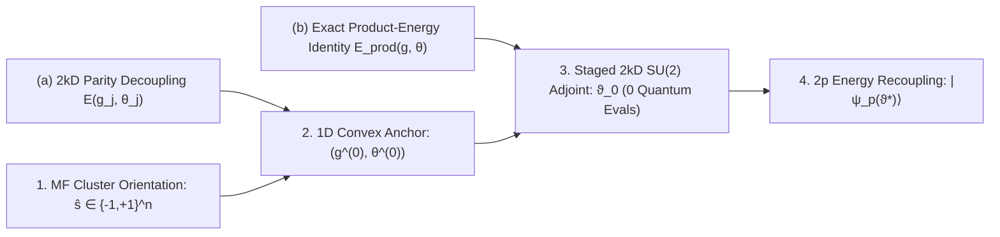

# Training-free mean-field adjoint manifold initialization for constrained variational quantum optimization

## Abstract

Constrained combinatorial optimization with the Quantum Approximate Optimization Algorithm (QAOA) must navigate rugged landscapes induced by competing local fields and quadratic spin couplings. Homogeneous annealing ramps apply uniform phases across qubits and require dozens of noisy online measurements for selection, whereas warm-start schemes alter the circuit ansatz and forfeit native global-pulse execution. Here we prove that within the unmodified depth-$2k$ global QAOA circuit, anti-symmetric cost pairing with odd-layer spin flips achieves $2k$-dimensional parity cancellation of quadratic couplings, establishing an exact quantum-classical product-energy identity. Exploiting this identity, we introduce `Echo-MF-2kD`, a training-free initializer integrating temperature-continuation mean-field orientation, Daubechies maximally flat anchors, and $O(kn)$ $\mathrm{SU}(2)$-adjoint refinement. Across 1,024 Maximum Weight Independent Set instances at $n=10$ and 5,120 cross-scale instances spanning $n=6\text{--}14$, `Echo-MF-2kD` requires zero Stage-1 measurements, doubles Trotterized Quantum Annealing ground-state probability ($46.16\%$ versus $22.42\%$ at $n=10$), cuts Stage-2 energy–gradient evaluations by $45.2\%$, and achieves $100\%$ shot-noise selection immunity.

## Introduction

Constrained combinatorial optimization problems—such as Maximum Weight Independent Set (MWIS)—arise across network allocation and statistical physics, mapping to Ising Hamiltonians $H_C = H_J + H_h + C$ over $n$ spins $s \in \{-1, +1\}^n$ (Lucas, 2014; Pichler et al., 2018; Ebadi et al., 2022). Under hard-constraint penalties, heterogeneous vertex degrees induce strong site-specific local fields $H_h = \sum_i h_i S_i$ competing with repulsive quadratic couplings $H_J = \sum_{i<j} J_{ij} S_i S_j$ (Hadfield et al., 2019). The Quantum Approximate Optimization Algorithm (QAOA) prepares a $p$-layer state $|\psi_p(\vartheta)\rangle = \prod_{\ell=1}^p U_B(\beta_\ell) U_C(\gamma_\ell) |+\rangle^{\otimes n}$ via cost unitaries $U_C(\gamma_\ell) = e^{-i\gamma_\ell H_C}$ and global transverse-field mixers $U_B(\beta_\ell) = e^{-i\beta_\ell \sum_i X_i}$ (Farhi et al., 2014; Preskill, 2018; Cerezo et al., 2021; Blekos et al., 2024). Preserving $|+\rangle^{\otimes n}$ and global mixers $U_B(\beta_\ell)$ is vital for superconducting processors (Harrigan et al., 2021), trapped-ion simulators (Pagano et al., 2020), and Rydberg atom arrays (Ebadi et al., 2022), where a single global pulse drives all qubits natively. At fixed depth $p$, however, the non-convex $2p$-dimensional energy landscape contains exponentially many suboptimal minima and symmetric branches (McClean et al., 2018; Shaydulin et al., 2019; Lotshaw et al., 2021; Shaydulin et al., 2021; You & Wu, 2021; Bittel & Kliesch, 2021; Anschuetz & Kiani, 2022). Because each parameter-shift gradient step requires $O(p)$ circuit executions and thousands of measurement shots (Mitarai et al., 2018; Wierichs et al., 2022), computing a high-overlap starting point $\vartheta_0 \in \mathbb{R}^{2p}$ solely from $(J, h)$ without circuit modification or online selection measurements is a central challenge.

Existing QAOA initializers face fundamental trade-offs under heterogeneous local fields. First, homogeneous schedules—including Trotterized Quantum Annealing (TQA) (Farhi et al., 2001; Kadowaki & Nishimori, 1998; Yang et al., 2017; Sack & Serbyn, 2021; Wurtz & Love, 2022), layerwise interpolation (INTERP) (Crooks, 2018; Zhou et al., 2020), and parameter transfer (Brandao et al., 2018; Galda et al., 2021; Shaydulin et al., 2023)—apply identical phase ramps across all qubits and cannot resolve site-specific spin orientations on conflicting edges (Katial et al., 2025); moreover, online TQA requires dozens of Stage-1 quantum evaluations vulnerable to shot-noise misselection ("Winner's Curse"). Second, ansatz-modifying schemes such as Semidefinite-Programming (SDP) Warm-Start QAOA (Bravyi et al., 2020; Egger et al., 2021; Tate et al., 2023) and multi-angle `ma-QAOA` (Herrman et al., 2022) either replace uniform mixers with site-specific rotations—forfeiting native global-pulse compatibility and risking spin freezing unless regularized—or inflate parameter dimension to $O(p(|V|+|E|))$ at prohibitive measurement cost. Third, spin-echo parity decoupling within the standard global circuit (Hahn, 1950; Carr & Purcell, 1954; Viola et al., 1999; Vandersypen & Chuang, 2005; Yao, 2026) pairs anti-symmetric cost angles $(-g_j, g_j)$ with odd-layer flips $\beta_{2j-1} = \pi/2$ to cancel $H_J$ along a one-dimensional (1D) scalar ray $g_j = a r_j$ (Daubechies, 1988; Low et al., 2016; Low & Chuang, 2017; Gilyén et al., 2019; Yao, 2026). Without offline supervision, however, restricting all $k$ pairs to one scalar $a$ encounters two barriers when $n > 2k$: (1) _Diophantine frequency crowding_, where one scalar cannot align $n > 2k$ incommensurate frequencies $4h_i$; and (2) _local effective-field inversion_, where weakly polarized qubits suffer repulsive pulls $(J\boldsymbol{m})_i$ upon Stage-2 coupling reactivation, flipping their local effective field $h_i^{\mathrm{eff}}(\boldsymbol{m}) = h_i + (J\boldsymbol{m})_i$.

To overcome both barriers without circuit modification or quantum measurements, we observe that parity cancellation of $H_J$ is an intra-pair algebraic identity rather than a 1D property. Because each spin-echo pair conjugates $H_C$ by the global flip operator $F = \prod_{i=1}^n X_i$ independently, exact cancellation of $H_J$ holds across the entire $2k$-dimensional complete-pair submanifold where all $k$ cost half-angles $\boldsymbol{g} \in \mathbb{R}^k$ and $k$ even-layer mixer angles $\boldsymbol{\theta} \in \mathbb{R}^k$ vary freely. On this $2k$-dimensional manifold, the $2p$-layer state factorizes strictly into single-qubit states computable in $O(kn)$ classical $2\times 2$ operations, and inter-qubit independence guarantees that the multi-body quantum expected energy equals the classical product-state energy identically: $\langle\psi_p(\boldsymbol{g},\boldsymbol{\theta})|H_C|\psi_p(\boldsymbol{g},\boldsymbol{\theta})\rangle \equiv E_{\mathrm{prod}}(\boldsymbol{g},\boldsymbol{\theta})$. This identity reduces quantum initialization to a differentiable classical control problem on $\mathrm{SU}(2)^{\otimes n}$ that anticipates multi-body coupling effects via $E_{\mathrm{prod}}$ and $h_i^{\mathrm{eff}}(\boldsymbol{m})$ before any quantum circuit runs.

Here we introduce Mean-Field Multi-Scalar Adjoint Product-Manifold Initialization (`Echo-MF-2kD`), a training-free, zero-quantum-selection framework mapping $(J, h)$ directly to standard $2p$-dimensional global QAOA angles. For non-vanishing local fields ($h_i \ne 0$) at positive even depth $p = 2k$, we prove that the $2k$-dimensional complete-pair submanifold preserves exact product factorization and product-energy equivalence while guaranteeing first-order linear reactivation of $H_J$ under symmetry-breaking Stage-2 perturbations. Algorithmically, `Echo-MF-2kD` resolves edge repulsion into a self-consistent binary orientation $\hat{\boldsymbol{s}} \in \{-1, +1\}^n$ via damped mean-field temperature continuation and single-edge cluster flips, extracts resonance anchors using the strict convexity of 1D Daubechies responses on zero-free intervals, and performs staged $O(kn)$ reverse-mode $\mathrm{SU}(2)$-adjoint refinement within a non-degenerate mixer domain to optimize flip-sensitivity-weighted log-likelihood, local effective-field inversion guards, and $E_{\mathrm{prod}}$, followed by Stage-2 full-angle recoupling (Dupont et al., 2022). Across 1,024 held-out MWIS instances at $n=10$, 5,120 cross-scale instances ($n \in \{6, 8, 10, 12, 14\}$), and 2,750 five-family benchmark instances, `Echo-MF-2kD` doubles online TQA ground-state probability at $n=10$ ($46.16\%$ versus $22.42\%$, reaching $60.80\%$ at $p=12$) with zero Stage-1 measurements, $45.2\%$ fewer Stage-2 energy–gradient evaluations, and $100\%$ Stage-1 shot-noise immunity.

---

## Results

### Exact product-energy identity on the $2k$-dimensional spin-echo manifold

**Figure 1 | Theoretical mechanism and training-free two-stage architecture of `Echo-MF-2kD`.** **a**, Pairing anti-symmetric cost angles $(-g_j, g_j)$ with odd-layer spin flips $U_B(\pi/2) \propto F$ cancels even-parity $H_J$ independently within each pair across free $(g_j, \theta_j) \in \mathbb{R}^2$. **b**, Exact tensor-product factorization across the $2k$-dimensional manifold equates the multi-body quantum expected energy identically to the classical product energy $E_{\mathrm{prod}}(\boldsymbol{g}, \boldsymbol{\theta})$. **c**, Training-free deployment maps unseen $(J, h)$ via temperature-continuation cluster orientation to $\hat{\boldsymbol{s}} \in \{-1, +1\}^n$ (1), extracts 1D Daubechies zero-free convex-interval anchors $(\boldsymbol{g}^{(0)}, \boldsymbol{\theta}^{(0)})$ (2), refines all $2k$ parameters via $O(kn)$ $\mathrm{SU}(2)$-adjoint L-BFGS-B under non-degenerate mixer bounds and inversion guards $h_i^{\mathrm{eff}}(\boldsymbol{m})$ with zero quantum evaluations to output $\vartheta_0 \in \mathbb{R}^{2p}$ (3), and releases all $2p$ angles in Stage 2 to reactivate $H_J$ entanglement (4).

In a standard global QAOA circuit of positive even depth $p = 2k$, pairing adjacent layers $2j-1$ and $2j$ ($j = 1, \ldots, k$) with anti-symmetric cost angles $(\gamma_{2j-1}, \gamma_{2j}) = (-g_j, g_j)$ and mixer angles $(\beta_{2j-1}, \beta_{2j}) = (\pi/2, \theta_j)$ sets every odd-layer mixer equal to the global spin-flip operator $U_B(\pi/2) = (-i)^n F$, where $F = \prod_{i=1}^n X_i$. Because quadratic spin-spin couplings are even under global spin inversion ($F H_J F = H_J$) whereas local external fields are odd ($F H_h F = -H_h$), the composite unitary of the $j$-th pair simplifies identically to $E(g_j, \theta_j) = U_B(\theta_j) e^{-2i g_j H_h} F$ up to a global phase (Yao, 2026) (Methods). Crucially, this operator cancellation occurs _within each pair individually_ and imposes no cross-pair ratio constraints on $(g_j, \theta_j)$. Consequently, across the entire $2k$-dimensional complete-pair parameter submanifold $(\boldsymbol{g}, \boldsymbol{\theta}) = (g_1, \ldots, g_k, \theta_1, \ldots, \theta_k) \in [-10\pi, 10\pi]^k \times [-\pi/2, \pi/2)^k$, the $2p$-layer quantum circuit output factorizes strictly into a tensor product of single-qubit states $|\psi_p(\boldsymbol{g}, \boldsymbol{\theta})\rangle = \bigotimes_{i=1}^n u_i^{(k)}(\boldsymbol{g}, \boldsymbol{\theta})$, whose positive-spin probabilities $p_i^+(\boldsymbol{g}, \boldsymbol{\theta}) = |u_{i,+}^{(k)}|^2$ and magnetizations $m_i(\boldsymbol{g}, \boldsymbol{\theta}) = 2p_i^+ - 1 \in [-1, 1]$ are evaluated deterministically in $O(kn)$ time via $k$ steps of $2\times 2$ unitary recursion. Because Pauli-$Z$ observables on distinct qubits are statistically independent in any product state ($\langle Z_i Z_j \rangle = m_i m_j$ for $i \ne j$), the multi-body quantum expected energy on the $2k$-dimensional submanifold equals the classical product-state energy identically:

$$
\langle\psi_p(\boldsymbol{g},\boldsymbol{\theta})|H_C|\psi_p(\boldsymbol{g},\boldsymbol{\theta})\rangle \equiv E_{\mathrm{prod}}(\boldsymbol{g},\boldsymbol{\theta}) = \frac{1}{2}\boldsymbol{m}(\boldsymbol{g},\boldsymbol{\theta})^\top J\boldsymbol{m}(\boldsymbol{g},\boldsymbol{\theta}) + \boldsymbol{h}^\top\boldsymbol{m}(\boldsymbol{g},\boldsymbol{\theta}) + C.
$$

Furthermore, perturbing the $j$-th pair's cost angles along the symmetry-breaking coordinate $(-g_j + \delta_j, g_j + \delta_j)$ in Stage 2 yields the pair operator $U_B(\theta_j) e^{-2i\delta_j H_J} e^{-2i g_j H_h} F$, which re-activates the quadratic coupling generator $H_J$ linearly at $O(\delta_j)$ and induces non-vanishing energy tangent gradients under non-degenerate even-layer mixers ($\theta_j \notin \{0, \pm\pi/2\}$; Methods).

This exact quantum–classical correspondence enables classical optimization of $E_{\mathrm{prod}}(\boldsymbol{g}, \boldsymbol{\theta})$ and single-qubit phase alignment across all $2k$ degrees of freedom with zero quantum circuit executions (Figure 1). Our framework (`Echo-MF-2kD` in online training-free mode; `Echo-Flat-2kD` in offline known-target analysis) comprises three mechanistic stages detailed in Methods: (1) _deterministic temperature-continuation cluster orientation_, which continues damped mean-field magnetizations across an ascending inverse-temperature schedule with zero-temperature single-edge cluster swaps to resolve soft-marginal ambiguity into a self-consistent binary orientation $\hat{\boldsymbol{s}} \in \{-1, +1\}^n$; (2) _Daubechies maximally flat convex-interval anchor extraction_, which exploits the strict convexity of 1D Daubechies negative log-likelihood on zero-free intervals to extract resonance anchors $(\boldsymbol{g}^{(0)}, \boldsymbol{\theta}^{(0)})$ via bisection; and (3) _staged $O(kn)$ reverse-mode $\mathrm{SU}(2)$-adjoint refinement_, which backpropagates analytical gradients through the $k$-step $2\times 2$ spinor recursion (Step 1a aligning $k$ cost angles $\boldsymbol{g}$, Step 1b jointly refining $(\boldsymbol{g}, \boldsymbol{\theta})$ within a non-degenerate mixer bound $|\theta_j| \le \theta_{\max} < \pi/2$) to optimize flip-sensitivity-weighted log-likelihood, local effective-field inversion guards, and $E_{\mathrm{prod}}$.

**Table 1 | Progressive component ablation from 1D scalar scanning to guarded staged $2k$D manifold refinement on unseen MWIS test sets.** Values report mean initial $\rightarrow$ post-optimization ground-state probabilities $P_{\mathrm{gs}}^{\mathrm{init}} \rightarrow P_{\mathrm{gs}}^{\mathrm{final}}$ (%) with 4,000-resample bootstrap 95% confidence intervals (CIs) and Stage-1 all-qubit quadrant hit rates ($\forall i: h_i \ne 0, \pi_i > 0.50$; %, in parentheses) across $n \in \{8, 10, 12\}$ at fixed depth $p = 10$ ($k = 5$ pairs; 1,024 unseen test instances per scale). Offline known-target (`Echo-Flat-*`) and online training-free (`Echo-MF-*`, input $(J, h)$ only, 0 online quantum evaluations) modes share identical Stage-2 L-BFGS-B settings. Bold values denote the best final ground-state probability within each mode.

| Mode        | Variant                       | Manifold & Guard Setup                                        |                           $n = 8$                            |                           $n = 10$                           |                           $n = 12$                           |
| :---------- | :---------------------------- | :------------------------------------------------------------ | :----------------------------------------------------------: | :----------------------------------------------------------: | :----------------------------------------------------------: |
| **Offline** | **Echo-Flat-1D**              | 1D scalar $a$ (convex bisection)                              |     $33.19 \rightarrow 77.25^{+1.36}_{-1.34}$ ($46.0$)       |     $13.07 \rightarrow 53.08^{+1.51}_{-1.57}$ ($18.8$)       |      $3.69 \rightarrow 29.64^{+1.33}_{-1.25}$ ($4.4$)        |
|             | **Echo-Flat-kD** (Cost-Only)  | $k$D cost $\boldsymbol{g}$ (unguarded NLL)                    |     $35.02 \rightarrow 78.47^{+1.19}_{-1.23}$ ($69.0$)       |     $15.17 \rightarrow 55.73^{+1.37}_{-1.38}$ ($37.7$)       |     $4.91 \rightarrow 33.63^{+1.22}_{-1.14}$ ($17.3$)        |
|             | **Echo-Flat-kD** (Guarded)    | $k$D cost $\boldsymbol{g}$ + guard + $E_{\mathrm{prod}}$      |     $33.05 \rightarrow 78.35^{+1.21}_{-1.24}$ ($49.3$)       |     $13.66 \rightarrow 54.79^{+1.47}_{-1.49}$ ($22.7$)       |      $4.09 \rightarrow 32.50^{+1.19}_{-1.22}$ ($6.5$)        |
|             | **Echo-Flat-2kD** (Unconstr.) | $2k$D $(\boldsymbol{g},\boldsymbol{\theta})$ (unguarded)      |     $71.52 \rightarrow 84.53^{+0.94}_{-0.95}$ ($94.4$)       |     $45.45 \rightarrow 64.03^{+1.20}_{-1.25}$ ($88.8$)       |     $23.40 \rightarrow 41.36^{+1.19}_{-1.19}$ ($77.8$)       |
|             | **Echo-Flat-2kD**             | Staged $2k$D + guard + $E_{\mathrm{prod}}$                    | $70.89 \rightarrow \mathbf{85.01}^{+0.92}_{-0.93}$ ($94.0$)  | $44.31 \rightarrow \mathbf{64.29}^{+1.22}_{-1.24}$ ($86.4$)  | $22.87 \rightarrow \mathbf{41.41}^{+1.18}_{-1.15}$ ($75.0$)  |
| **Online**  | **Echo-MF-Flat** (1D)         | Soft MF + 1D overlap                                          |     $15.96 \rightarrow 45.11^{+2.41}_{-2.40}$ ($0.0$)        |      $5.39 \rightarrow 23.23^{+1.83}_{-1.92}$ ($0.0$)        |      $1.26 \rightarrow 9.74^{+1.21}_{-1.12}$ ($0.0$)         |
|             | **Echo-MF-kD** (Soft, Cost)   | Soft MF + unguarded $k$D $\boldsymbol{g}$                     |     $21.08 \rightarrow 46.96^{+2.36}_{-2.35}$ ($73.2$)       |     $8.16 \rightarrow 23.83^{+1.82}_{-1.77}$ ($39.6$)        |     $2.51 \rightarrow 9.65^{+1.08}_{-1.04}$ ($22.0$)         |
|             | **Echo-MF-kD** (Guarded)      | Cluster $\hat{\boldsymbol{s}}$ + guarded $k$D $\boldsymbol{g}$ |     $32.47 \rightarrow 61.64^{+2.17}_{-2.26}$ ($49.2$)       |     $13.03 \rightarrow 31.58^{+1.99}_{-1.96}$ ($22.5$)       |      $3.89 \rightarrow 12.31^{+1.27}_{-1.26}$ ($6.3$)        |
|             | **Echo-MF-2kD** (Unconstr.)   | Cluster $\hat{\boldsymbol{s}}$ + unguarded $2k$D              |     $70.03 \rightarrow 74.69^{+1.64}_{-1.69}$ ($94.3$)       | $43.20 \rightarrow \mathbf{46.75}^{+1.77}_{-1.85}$ ($88.8$)  | $21.88 \rightarrow \mathbf{23.34}^{+1.40}_{-1.40}$ ($77.6$)  |
|             | **Echo-MF-2kD**               | Cluster $\hat{\boldsymbol{s}}$ + staged $2k$D                 | $69.41 \rightarrow \mathbf{74.99}^{+1.65}_{-1.68}$ ($93.8$)  |     $42.20 \rightarrow 46.70^{+1.78}_{-1.90}$ ($86.8$)       |     $21.38 \rightarrow 22.64^{+1.31}_{-1.38}$ ($74.2$)       |

Controlled ablations across 5,120 unseen MWIS instances confirm the distinct physical role of each mechanism (Table 1). First, in online unsupervised mode, fitting unoriented soft mean-field marginals (`Echo-MF-kD (Soft, Cost-Only)`) stalls at $23.83\%$ ($n=10$) and $9.65\%$ ($n=12$) because frustrated vertices with $\pi_i^{\mathrm{mf}} \approx 0.5$ pull optimization toward incompatible independent-set branches. Introducing deterministic temperature-continuation cluster orientation and effective-field inversion guards (`Echo-MF-kD (Guarded)`) lifts single-qubit spin orientation accuracy from $85.03\%\text{--}89.18\%$ to $93.75\%\text{--}99.61\%$ and raises online final probabilities by $+14.68$ and $+7.75$ percentage points (pp) at $n=8, 10$. Second, when system size exceeds the pair count ($n \ge 10 > k = 5$), tuning only the $k=5$ cost angles with frozen 1D Daubechies mixers (`Echo-Flat-kD` and `Echo-MF-kD`) cannot resolve Diophantine frequency crowding, limiting $n=12$ initial product probabilities to $3.89\%\text{--}4.91\%$ and all-qubit quadrant hit rates to $6.3\%\text{--}17.3\%$. Releasing all $2k=10$ parameters in Step 1b (`Echo-Flat-2kD` and `Echo-MF-2kD`) boosts the $n=12$ initial product probability more than fivefold to $21.38\%\text{--}22.87\%$ and lifts the quadrant hit rate to $75.0\%$ ($86.4\%\text{--}86.8\%$ at $n=10$). Third, while cluster orientation and unlocking all $2k$ parameters drive the primary accuracy leap, adding the non-degenerate mixer bound and inversion guard acts as a tangent-space stability safeguard—securing the top offline accuracy across $n=8, 10, 12$ ($\mathbf{85.01}\%, \mathbf{64.29}\%, \mathbf{41.41}\%$), matching trust-region-regularized `2kD (Unconstr.)` online ($\mathbf{94.02}\%, \mathbf{74.99}\%, 46.70\%, 22.64\%, 10.13\%$ across $n=6\text{--}14$; $+5.81\text{--}+29.88$ pp over 1D `Echo-MF-Flat`), and cutting Stage-2 energy–gradient evaluations from $102.3\text{--}122.5$ down to $\mathbf{61.3\text{--}79.3}$.

---

### Doubling ground-state probability while halving quantum search cost

**Figure 2 | `Echo-MF-2kD` more than doubles the final ground-state probability of online TQA while halving Stage-2 quantum gradient calls on held-out MWIS instances ($n=10$, 1,024 unseen test instances).** **a**, Cross-depth instance-averaged Stage-1 initial product-state ground-state probability $P_{\mathrm{gs}}^{(0)}$ and Stage-2 post-optimization final ground-state probability $P_{\mathrm{gs}}$ across $p \in \{8, 10, 12\}$. **b**, Final mean ground-state probability scaling as a function of circuit depth $p = 8, 10, 12$; error bars denote 4,000-resample non-parametric percentile bootstrap 95% CIs. **c**, Empirical cumulative distribution functions (ECDFs) of cross-depth mean final ground-state probability across all 1,024 test instances, highlighting high-probability instance coverage ($P_{\mathrm{gs}} \ge 50\%$). **d**, Per-instance paired net probability gains ($\Delta P_{\mathrm{gs}}$, in percentage points) of `Echo-MF-2kD` over 32-evaluation online TQA and 1D `Echo-MF-Flat` across circuit depths.

**Table 2 | Stage-wise quantum evaluation cost and initial-to-final ground-state probabilities on the held-out MWIS center test set ($n=10$, 1,024 unseen instances).** All methods receive only $(J, h)$ with zero training data and execute identical Stage-2 L-BFGS-B optimization, grouped into prior-free/homogeneous heuristics, 1D mean-field overlap decoders, and staged $2k$D adjoint refinement (`Echo-MF-2kD`). Values report Stage-1 quantum evaluations, mean Stage-2 energy–gradient evaluations across $p \in \{8, 10, 12\}$ (`Echo-MF-2kD`: $46.7/63.6/84.1$ vs. `Echo-MF-Flat`: $71.6/102.5/125.1$ and `TQA`: $99.7/121.0/134.2$), initial $\rightarrow$ final probabilities ($P_{\mathrm{gs}}^{(0)} \rightarrow P_{\mathrm{gs}}$, %) with 95% CIs, and paired net gains over `TQA`. Bold marks column optima.

| Method           | Stage-1 Evals | Stage-2 Evals |                      $p = 8$                       |                      $p = 10$                      |                      $p = 12$                      | Cross-Depth Mean (%) | Gain vs. TQA (pp)                  |
| :--------------- | :--------------: | :--------------: | :------------------------------------------------: | :------------------------------------------------: | :------------------------------------------------: | :---------------------: | :-----------------------------------: |
| **RI (1)**       |       $0$        |     $125.2$      |       $0.10 \rightarrow 3.84^{+0.60}_{-0.57}$       |       $0.10 \rightarrow 6.82^{+0.90}_{-0.87}$       |      $0.10 \rightarrow 10.42^{+1.23}_{-1.20}$       |   $0.10 \rightarrow 7.03$   |     $-15.39\ ([-16.18, -14.65])$      |
| **RI (32)**      |       $32$       |     $134.0$      |       $0.22 \rightarrow 6.47^{+0.62}_{-0.60}$       |       $0.20 \rightarrow 9.93^{+0.87}_{-0.81}$       |      $0.17 \rightarrow 12.81^{+1.02}_{-0.97}$       |   $0.20 \rightarrow 9.73$   |     $-12.69\ ([-13.41, -11.98])$      |
| **Echo-Energy**  |       $0$        |      $93.0$      |      $4.34 \rightarrow 10.68^{+1.54}_{-1.48}$       |      $4.70 \rightarrow 14.09^{+1.77}_{-1.75}$       |      $4.91 \rightarrow 17.86^{+2.03}_{-1.94}$       |  $4.65 \rightarrow 14.21$   |       $-8.21\ ([-9.88, -6.47])$       |
| **TQA**          |       $32$       |     $118.3$      |      $4.60 \rightarrow 17.05^{+0.56}_{-0.56}$       |      $6.81 \rightarrow 21.94^{+0.68}_{-0.68}$       |      $8.23 \rightarrow 28.27^{+0.92}_{-0.91}$       |  $6.55 \rightarrow 22.42$   |             Ref. ($0.00$)             |
| **Echo-MF-Alt**  |       $0$        |     $117.6$      |       $3.00 \rightarrow 8.53^{+0.84}_{-0.82}$       |      $2.73 \rightarrow 13.53^{+1.18}_{-1.22}$       |      $2.77 \rightarrow 18.65^{+1.47}_{-1.58}$       |  $2.83 \rightarrow 13.57$   |       $-8.85\ ([-9.72, -7.98])$       |
| **Echo-MF-End**  |       $0$        |     $120.1$      |      $4.43 \rightarrow 13.10^{+1.25}_{-1.23}$       |      $4.44 \rightarrow 18.24^{+1.43}_{-1.42}$       |      $4.45 \rightarrow 22.83^{+1.65}_{-1.57}$       |  $4.44 \rightarrow 18.06$   |       $-4.36\ ([-5.61, -3.11])$       |
| **Echo-MF-Flat** |   $\mathbf{0}$   |      $99.8$      |      $5.13 \rightarrow 16.05^{+1.52}_{-1.56}$       |      $5.39 \rightarrow 23.23^{+1.83}_{-1.92}$       |      $5.69 \rightarrow 29.28^{+2.08}_{-2.17}$       |  $5.40 \rightarrow 22.85$   |       $+0.43\ ([-1.26, +2.08])$       |
| **Echo-MF-2kD**  |   $\mathbf{0}$   | $\mathbf{64.8}$  | $\mathbf{29.28} \rightarrow \mathbf{30.98}^{+1.67}_{-1.68}$ | $\mathbf{42.20} \rightarrow \mathbf{46.70}^{+1.78}_{-1.90}$ | $\mathbf{53.85} \rightarrow \mathbf{60.80}^{+1.82}_{-1.91}$ | $\mathbf{41.77} \rightarrow \mathbf{46.16}$ | $\mathbf{+23.74}\ ([+22.06, +25.43])$ |

Across all 1,024 held-out MWIS center test instances ($n=10, p \in \{8, 10, 12\}$), `Echo-MF-2kD` resolves the accuracy–efficiency dilemma by achieving a cross-depth mean final ground-state probability of $\mathbf{46.16}\%$ ($\mathbf{30.98}\%, \mathbf{46.70}\%, \mathbf{60.80}\%$ at $p=8, 10, 12$), outperforming 32-evaluation online `TQA` ($22.42\%$) by $\mathbf{+23.74}$ pp ($2.06\times$ `TQA`), 32-evaluation `RI (32)` ($9.73\%$) by $+36.43$ pp ($4.74\times$), and 1D `Echo-MF-Flat` ($22.85\%$) by $+23.31$ pp (Figure 2a, b and Table 2). Before executing a single quantum circuit evaluation, the Stage-1 classical product state prepared by `Echo-MF-2kD` already attains a mean initial probability $P_{\mathrm{gs}}^{(0)}$ of $\mathbf{41.77}\%$ ($\mathbf{53.85}\%$ at $p=12$)—reaching $1.86\times$ the _final post-optimization_ probability of `TQA` after 32 selection and 118.3 gradient quantum evaluations. In the instance-level ECDF (Figure 2c, d), `Echo-MF-2kD` achieves per-instance win rates over `TQA` of $60.8\%\text{--}80.6\%$ (paired gains $+13.93\text{--}+32.53$ pp) and lifts high-probability instance coverage ($P_{\mathrm{gs}} \ge 50\%$) to $\mathbf{45.7}\%$, versus $3.6\%$ for `TQA` ($12.7\times$) and $18.6\%$ for `Echo-MF-Flat` ($2.5\times$).

Mechanistically, this simultaneous leap in solution quality and search speed stems from pre-aligning single-qubit phases inside the true ground-state basin on the $2k$-dimensional product manifold. Because homogeneous `TQA` ramps and random starts begin far from the heterogeneous ground state ($P_{\mathrm{gs}}^{(0)}$ of $4.60\%\text{--}8.23\%$ and $0.17\%\text{--}0.22\%$), their Stage-2 L-BFGS-B trajectories must traverse rugged non-convex ridges, consuming an average of $118.3$ and $134.0$ gradient quantum evaluations. In contrast, Stage-1 cluster orientation resolves $\hat{\boldsymbol{s}} = s^\star$ on $94.92\%$ of instances ($972/1{,}024$, vs. $47.07\%$ for raw `Classical-MF`; $96.45\%$ per-qubit accuracy); because the unmodified global QAOA ansatz starts from $|+\rangle^{\otimes n}$ and cannot load classical bitstrings directly (cf. Table 1 offline), $2k$D adjoint compilation translates $\hat{\boldsymbol{s}}$ into global angles placing $76.8\%, 86.8\%, 91.0\%$ of instances inside the all-qubit target quadrant (reaching $32.64\%, 49.20\%, 64.06\%$ on the 972 oriented instances and $\approx 0.01\%$ on the 52 locally trapped instances). Starting deep inside the basin, Stage-2 L-BFGS-B converges in $\mathbf{46.7, 63.6, 84.1}$ energy–gradient evaluations (mean $\mathbf{64.8}$—a $\mathbf{45.2}\%$ reduction relative to `TQA` across identical $2p$-parameter circuits). Unlike circuit-modifying `Warm-Start QAOA` (Egger et al., 2021; Tate et al., 2023) ($60.81\%$ at $p=10$ using custom single-qubit mixers and 32 selection + $132.0$ Stage-2 evaluations) or `ma-QAOA` (Herrman et al., 2022) ($58.15\%$ using $\approx 350$ parameters and $138.0$ evaluations, $\approx 38\times$ more coordinate-shift evaluations than `Echo-MF-2kD`), `Echo-MF-2kD` preserves the native $2p$-angle global circuit.

---

### Cross-scale scaling laws across 5,120 instances and five Ising families

**Figure 3 | Cross-scale scaling across 5,120 MWIS test instances ($n \in \{6, 8, 10, 12, 14\}$) and immunity to projective measurement shot noise.** **a**, Uncapped equal-candidate (Top-1) offline scaling curves on MWIS at fixed depth $p = 10$ ($k = 5$ pairs) from $n = 6$ to $n = 14$ ($64$ to $16{,}384$ Hilbert-space dimensions, 1,024 unseen instances per scale) comparing `Echo-Flat-2kD`, `Echo-Flat-1D`, and `TQA`. **b**, Online training-free scaling on the exact same 5,120 instances showing oriented single-qubit spin accuracy (top curve) and zero-quantum-selection final ground-state probabilities of `Echo-MF-2kD` versus 32-evaluation online `TQA` and 1D `Echo-MF-Flat` (bottom bars). **c**, Stage-1 candidate selection shot-noise test ($n = 10, p = 10$, 1,024 instances) comparing `TQA`'s hit rate for selecting its noiseless optimal step size across $N_{\mathrm{shots}} \in \{16, 32, 64, 128, 256, 512, 1024\}$ against zero-quantum-measurement `Echo-MF` (identically $100\%$). **d**, End-to-end finite-shot two-point shifted-circuit variational optimization ($n = 10, p = 10$, 1,024 instances, 64 steps) across $N_{\mathrm{shots}} \in \{64, 256, 1024, 4096\}$. All error bars and shaded bands denote 4,000-resample bootstrap 95% CIs.

**Table 3 | Cross-scale MWIS evaluation across $n \in \{6, 8, 10, 12, 14\}$ at fixed depth $p = 10$ (1,024 unseen test instances per scale; 5,120 instances total).** **a**, Offline uncapped equal-candidate (Top-1 and Top-2) final ground-state probabilities (%) and paired net gains of `Echo-Flat-2kD` over `TQA`. **b**, Online training-free `Echo-MF-2kD` (0 Stage-1 quantum evaluations) and 1D `Echo-MF-Flat` versus online `TQA` (32 Stage-1 quantum evaluations) on the identical 5,120 instances, reporting single-qubit spin orientation accuracy (%), initial $\rightarrow$ final ground-state probabilities (%), and mean Stage-2 energy–gradient evaluations. Bold denotes comparison-group optima.

**a. Offline equal-candidate scaling (uncapped convergence, known target state)**

| Size $n$ | Echo-Flat-1D (Top-1) |    Echo-Flat-2kD (Top-1)      |    Echo-Flat-2kD (Top-2)      |        TQA (Top-1 / Top-2)         | Gain vs. TQA (Top-1, pp)           |
| :------: | :---------------------: | :------------------------------: | :------------------------------: | :-----------------------------------: | :-----------------------------------: |
|   $6$    | $94.37^{+0.69}_{-0.73}$ | $\mathbf{96.79}^{+0.48}_{-0.53}$ | $\mathbf{97.44}^{+0.39}_{-0.42}$ | $59.88^{+1.14}_{-1.13}\ /\ 62.18^{+1.15}_{-1.15}$ | $\mathbf{+36.91}\ ([+35.74, +38.02])$ |
|   $8$    | $77.25^{+1.36}_{-1.34}$ | $\mathbf{85.01}^{+0.92}_{-0.93}$ | $\mathbf{87.18}^{+0.83}_{-0.81}$ | $43.62^{+1.07}_{-1.02}\ /\ 45.53^{+1.08}_{-1.04}$ | $\mathbf{+41.39}\ ([+40.10, +42.72])$ |
|   $10$   | $53.08^{+1.51}_{-1.57}$ | $\mathbf{64.29}^{+1.22}_{-1.24}$ | $\mathbf{67.41}^{+1.13}_{-1.14}$ | $31.52^{+0.82}_{-0.84}\ /\ 33.06^{+0.86}_{-0.90}$ | $\mathbf{+32.76}\ ([+31.35, +34.17])$ |
|   $12$   | $29.64^{+1.33}_{-1.25}$ | $\mathbf{41.41}^{+1.18}_{-1.15}$ | $\mathbf{45.51}^{+1.10}_{-1.11}$ | $23.45^{+0.69}_{-0.66}\ /\ 24.48^{+0.69}_{-0.67}$ | $\mathbf{+17.96}\ ([+16.75, +19.16])$ |
|   $14$   | $17.47^{+0.96}_{-0.96}$ | $\mathbf{24.84}^{+0.95}_{-0.93}$ | $\mathbf{27.86}^{+0.95}_{-0.91}$ | $17.23^{+0.58}_{-0.53}\ /\ 18.16^{+0.62}_{-0.57}$ |  $\mathbf{+7.61}\ ([+6.66, +8.57])$   |

**b. Online training-free scaling (input $(J, h)$ only, unknown target state)**

| Size $n$ | Spin Acc. (%) |     Echo-MF-Flat (1D, 0 evals)      |        Echo-MF-2kD ($2k$D, 0 evals)          |        Online TQA (32 evals)        | Stage-2 Evals (Echo-MF-2kD / TQA) |
| :------: | :--------------: | :------------------------------------: | :---------------------------------------------: | :------------------------------------: | :----------------------------------: |
|   $6$    |     $99.61$      | $36.16 \rightarrow 68.49^{+2.34}_{-2.48}$ | $91.00 \rightarrow \mathbf{94.02}^{+0.96}_{-1.06}$ | $20.71 \rightarrow 45.19^{+1.15}_{-1.14}$ |       $\mathbf{79.3}\ /\ 129.0$       |
|   $8$    |     $98.32$      | $15.96 \rightarrow 45.11^{+2.41}_{-2.40}$ | $69.41 \rightarrow \mathbf{74.99}^{+1.65}_{-1.68}$ | $12.07 \rightarrow 31.64^{+0.95}_{-0.93}$ |       $\mathbf{68.6}\ /\ 121.7$       |
|   $10$   |     $96.45$      |  $5.39 \rightarrow 23.23^{+1.83}_{-1.92}$ | $42.20 \rightarrow \mathbf{46.70}^{+1.78}_{-1.90}$ |  $6.81 \rightarrow 21.94^{+0.68}_{-0.68}$ |       $\mathbf{63.6}\ /\ 121.0$       |
|   $12$   |     $95.57$      |  $1.26 \rightarrow 9.74^{+1.21}_{-1.12}$  | $21.38 \rightarrow \mathbf{22.64}^{+1.31}_{-1.38}$ |  $3.88 \rightarrow 15.55^{+0.54}_{-0.50}$ |       $\mathbf{62.6}\ /\ 119.6$       |
|   $14$   |     $93.75$      |  $0.46 \rightarrow 4.32^{+0.70}_{-0.66}$  | $\mathbf{10.12} \rightarrow 10.13^{+0.93}_{-0.90}$ | $2.17 \rightarrow \mathbf{10.94}^{+0.44}_{-0.40}$ |       $\mathbf{61.3}\ /\ 119.8$       |

Evaluating 5,120 unseen MWIS test instances across $n \in \{6, 8, 10, 12, 14\}$ at fixed depth $p = 10$ ($2k = 10$ manifold parameters) reveals how $2k$-dimensional refinement reshapes scaling in the overcomplete $n > 2k$ regime (Figure 3a, b and Table 3). In offline equal-candidate comparisons (Table 3a), 1D `Echo-Flat-1D (Top-1)` suffers severe Diophantine frequency crowding once $n \ge 12 > 2k$, with initial product probabilities dropping to $3.69\%$ ($n=12$) and $1.29\%$ ($n=14$). Unlocking all $2k=10$ intra-pair degrees of freedom in `Echo-Flat-2kD` boosts initial product probabilities by $6.2\text{--}8.6\times$ in the overcomplete regime (to $22.87\%$ at $n=12$ and $11.08\%$ at $n=14$). After Stage-2 recoupling, `Echo-Flat-2kD (Top-1)` outperforms both `TQA (Top-1)` and `Echo-Flat-1D (Top-1)` across all five system sizes with paired net gains over `TQA` of $\mathbf{+36.91}, \mathbf{+41.39}, \mathbf{+32.76}, \mathbf{+17.96}$, and $\mathbf{+7.61}$ pp (reaching Top-1 / Top-2 probabilities of $\mathbf{64.29}\% / \mathbf{67.41}\%$, $\mathbf{41.41}\% / \mathbf{45.51}\%$, and $\mathbf{24.84}\% / \mathbf{27.86}\%$ at $n=10, 12, 14$; all 95% CIs strictly positive).

In online training-free mode (Table 3b), 1D soft-marginal overlap decoding (`Echo-MF-Flat`) outperforms `TQA` at $n \le 10$ but collapses at $n=12, 14$ ($9.74\%, 4.32\%$) as unoriented soft marginals compound 1D frequency crowding. Conversely, temperature-continuation cluster orientation in `Echo-MF-2kD` sustains $93.75\%\text{--}99.61\%$ single-qubit orientation accuracy across all 5,120 instances. With zero Stage-1 measurements, `Echo-MF-2kD` achieves final probabilities of $\mathbf{94.02}\%, \mathbf{74.99}\%, \mathbf{46.70}\%, \mathbf{22.64}\%$ across $n=6, 8, 10, 12$—beating 32-evaluation online `TQA` by $\mathbf{+48.83}, \mathbf{+43.35}, \mathbf{+24.76}, \mathbf{+7.09}$ pp while cutting Stage-2 energy–gradient evaluations roughly in half ($\mathbf{61.3\text{--}79.3}$ versus $119.6\text{--}129.0$). At $n=14$, where large conflict penalties ($Q = 2\max_i v_i$) steepen excited-state energy barriers, `Echo-MF-2kD`'s zero-measurement Stage-1 classical product state ($\mathbf{10.12}\%$, $4.7\times$ `TQA`'s initial $2.17\%$ and $22\times$ `Echo-MF-Flat`'s $0.46\%$) already matches the final post-optimization probability of online `TQA` ($10.94\%$).

Offline uncapped boundary experiments at $n=11, 12$ ($p=10$, 500 instances; Extended Data Table 1) across five canonical Ising families (`MWIS`, `Dense Ising`, `Sparse Ising`, `Grid Ising`, and `Pinned MaxCut`; Yao, 2026) delineate the regime of advantage. On heterogeneous positive-field `MWIS`, `Echo-Flat-2kD` outperforms `Echo-Flat-1D` by $+12.05$ and $+10.57$ pp ($\mathbf{56.69}\%$ and $\mathbf{41.66}\%$) and offline `TQA` by $\mathbf{+28.81}$ and $\mathbf{+16.56}$ pp. On zero-mean Gaussian `Dense`, `Sparse`, and `Grid Ising`, $2k$D refinement lifts Stage-1 product-state overlap from $5.05\%\text{--}9.12\%$ to $24.70\%\text{--}37.47\%$, whereas coupling-driven `TQA` attains higher post-recoupling probabilities ($53.00\%\text{--}64.26\%$ vs. $42.55\%\text{--}56.27\%$) under symmetric frustrated couplings. On interior-field-free `Pinned MaxCut` ($h_i = 0$), both 1D and $2k$D initial probabilities obey the $2^{-n_0}$ bound ($0.20\%\text{--}0.37\%$), confirming that pure Echo evolution requires non-vanishing local fields $H_h$.

---

### Shot-noise immunity and early-stopping efficiency

Under realistic quantum hardware execution, projective measurements introduce multinomial shot noise of scale $O(N_{\mathrm{shots}}^{-1/2})$ into every energy evaluation. Across all 1,024 held-out MWIS center test instances ($n=10, p=10$), online `TQA` suffers severe Stage-1 misselection ("Winner's Curse") when picking the lowest empirical energy among its 32 candidate step sizes (Figure 3c and Extended Data Table 2): at $N_{\mathrm{shots}} = 16, 32, 64$, statistical fluctuations limit `TQA`'s noiseless-optimum hit rate to $36.86\%, 44.86\%, 51.02\%$, reaching only $78.20\%$ at $N_{\mathrm{shots}} = 1024$. Because `Echo-MF-2kD` and `Echo-MF-Flat` execute Stage-1 manifold refinement deterministically on a classical processor with zero quantum measurements, their Stage-1 candidate selection is $100\%$ immune to shot noise across all shot budgets.

When both Stage-1 selection and 64-step Stage-2 two-point shifted-circuit optimization ($\delta = 0.10$ rad; 1 initial plus $2 \times 2p + 1 = 41$ circuit evaluations per step, $1 + 41t$ cumulative) operate under finite measurement shots $N_{\mathrm{shots}} \in \{64, 256, 1024, 4096\}$, `Echo-MF-2kD` achieves substantial measurement savings and noise resilience (Figure 3d and Extended Data Table 2). With zero quantum measurements (0 steps), `Echo-MF-2kD`'s classical product initial state ($\mathbf{42.20}^{+1.55}_{-1.70}\%$) already exceeds $2.2\text{--}2.9\times$ the final probability of 64-step noisy `TQA` ($14.63\%\text{--}18.93\%$ after $2{,}657$ circuit evaluations). With early stopping at 16 steps ($657$ evaluations, saving $75.3\%$ of shots) and 32 steps ($1{,}313$ evaluations, saving $50.6\%$ of shots), `Echo-MF-2kD` reaches $39.54\%\text{--}44.18\%$ and $40.65\%\text{--}45.77\%$, outperforming 64-step `TQA` by $\mathbf{+24.90\text{--}+25.47}$ pp and $\mathbf{+26.02\text{--}+27.03}$ pp. At 64 steps ($2{,}625$ evaluations), `Echo-MF-2kD` reaches $\mathbf{42.67}\%\text{--}\mathbf{46.44}\%$ (converging smoothly toward its matched noiseless Adam limit of $46.61\%$), a paired net gain of $\mathbf{+27.51\text{--}+28.26}$ pp over `TQA`.

---

## Discussion

By proving that exact spin-echo parity cancellation of quadratic couplings $H_J$ extends from a 1D scalar ray to the entire $2k$-dimensional complete-pair submanifold inside the unmodified depth-$2k$ global QAOA circuit, this work establishes an exact equivalence between multi-body quantum expected energy and classical product-state energy: $\langle\psi_p(\boldsymbol{g},\boldsymbol{\theta})|H_C|\psi_p(\boldsymbol{g},\boldsymbol{\theta})\rangle \equiv E_{\mathrm{prod}}(\boldsymbol{g},\boldsymbol{\theta})$. This structural insight resolves the long-standing tension between hardware-native circuit execution and site-specific phase initialization. Rather than modifying the quantum circuit ansatz with site-customized mixers (Egger et al., 2021; Tate et al., 2023) or expending online quantum evaluations on homogeneous annealing grids (Sack & Serbyn, 2021), `Echo-MF-2kD` exploits the hidden integrable $2k$-dimensional product submanifold to align heterogeneous single-qubit phases and suppress effective-field inversions purely on a classical processor before launching full-angle quantum entanglement optimization.

Beyond QAOA, our three-stage division of labor—classical mean-field topological orientation, exact adjoint control on an embedded symmetry-decoupled product manifold, and symmetry-breaking multi-body recoupling (Dupont et al., 2022)—provides a general methodological blueprint for parameterized quantum circuits and many-body variational simulation. Whenever a target Hamiltonian decomposes into terms of opposite parity under a global hardware-native symmetry operation (such as global Pauli flips in spin lattices or particle-hole conjugation in fermionic systems), inserting symmetry pivots carves out a classically tractable low-dimensional submanifold within the deep variational ansatz. Pre-optimizing classical surrogate energies and local stability guards on this exact submanifold via reverse-mode $\mathrm{SU}(2)$ adjoint differentiation ($O(kn + |E|)$ per sparse-graph gradient step) avoids barren plateaus and shot-noise misselection while keeping complete multi-anchor Stage-1 preprocessing in low-order polynomial classical time ($\approx 0.28$ s per $n=10$ instance on one CPU core, versus $O(n^{3.5})$ semidefinite programming).

Our theoretical assumptions and cross-family experiments also delineate two clear operational boundaries. First, because single-qubit phase evolution $e^{-2i g_j H_h}$ on the complete Echo-pair submanifold is generated exclusively by local external fields $H_h$, problems with identically zero local fields ($h = 0$, such as unweighted MaxCut or interior vertices of `Pinned MaxCut`) experience no phase differentiation on the pure Echo manifold; extending `Echo-MF-2kD` to field-free graphs requires pinning a reference vertex or applying a single mean-field symmetry-breaking layer to induce effective local fields. Second, when system size scales into the deep overcomplete regime ($n = 14 > 2k = 10$) under large constraint penalties ($Q = 2\max_i v_i$), although `Echo-MF-2kD`'s zero-measurement Stage-1 product state ($10.12\%$) matches the final post-optimization probability of online `TQA` ($10.94\%$), Stage-2 optimization of the expected energy $\langle H_C \rangle$ prioritizes suppressing high-penalty excited tails over amplifying the ground-state peak ($10.12\% \rightarrow 10.13\%$). Replacing the Stage-2 expected-energy objective with tail-focused Conditional Value-at-Risk (CVaR) objectives or scaling circuit depth proportionally with system size ($p \propto n$) on neutral Rydberg atom arrays offers a direct path to hundred-qubit constrained quantum optimization.

---

## Methods

### Problem Formulation and Theoretical Preliminaries

**Normalized Ising Hamiltonian and standard global QAOA ansatz.** We consider an $n$-qubit Ising energy function with local external fields over spin configurations $s \in \{-1, +1\}^n$ (mapped to binary variables via $x_i = (1 + s_i)/2 \in \{0, 1\}$):

$$
E(s) = \frac{1}{2}s^\top J s + h^\top s + C, \qquad s \in \{-1, +1\}^n,
$$

where $J \in \mathbb{R}^{n \times n}$ is symmetric with zero diagonal and $h \in \mathbb{R}^n$ is the local external field vector. To standardize energy scales across problem families and graph sizes without altering configuration ordering or energy gap ratios, raw coefficients $(J_{\mathrm{raw}}, h_{\mathrm{raw}}, C_{\mathrm{raw}})$ are normalized by the per-qubit root-mean-square (RMS) scale factor $\lambda = \sqrt{(\|J_{\mathrm{raw}}\|_F^2 + \|h_{\mathrm{raw}}\|_2^2)/n}$ to yield $J = J_{\mathrm{raw}}/\lambda$, $h = h_{\mathrm{raw}}/\lambda$, and $C = 0$, satisfying $(\|J\|_F^2 + \|h\|_2^2)/n = 1$. In the $2^n$-dimensional Hilbert space with computational basis states $|s\rangle$ and diagonal spin operators $S_i = \operatorname{diag}(-1, +1) = -Z_i$, the problem Hamiltonian is $H_C = H_J + H_h$, where $H_J = \sum_{1 \le i < j \le n} J_{ij} S_i S_j$ and $H_h = \sum_{i=1}^n h_i S_i$. A depth-$p$ standard global QAOA circuit applies alternating cost unitaries $U_C(\gamma_\ell) = e^{-i\gamma_\ell H_C}$ and global transverse-field mixer unitaries $U_B(\beta_\ell) = e^{-i\beta_\ell \sum_{i=1}^n X_i}$ to the uniform superposition $|+\rangle^{\otimes n}$, preparing $|\psi_p(\vartheta)\rangle = U_B(\beta_p)U_C(\gamma_p)\cdots U_B(\beta_1)U_C(\gamma_1)|+\rangle^{\otimes n}$ parameterized by $\vartheta = (\gamma_1, \ldots, \gamma_p, \beta_1, \ldots, \beta_p) \in [-10\pi, 10\pi]^p \times [-\pi/2, \pi/2)^p$.

**Complete spin-echo pair decoupling on the $2k$-dimensional submanifold.** Define the global spin-flip parity operator $F = \prod_{i=1}^n X_i$, which satisfies $F^\dagger = F$, $F^2 = I$, $F|s\rangle = |-s\rangle$, and $U_B(\pi/2) = (-i)^n F$. Under conjugation by $F$, the quadratic coupling and local field operators obey opposite parity relations:

$$
F H_J F = H_J, \qquad F H_h F = -H_h.
$$

For any positive even circuit depth $p = 2k$ ($k \ge 1$), we partition the $2k$ layers into $k$ adjacent _complete spin-echo pairs_ ($j = 1, \ldots, k$) by assigning anti-symmetric cost angles $(\gamma_{2j-1}, \gamma_{2j}) = (-g_j, g_j)$ and mixer angles $(\beta_{2j-1}, \beta_{2j}) = (\pi/2, \theta_j)$ (Yao, 2026). Because $H_C$ and $F H_C F$ are diagonal in the computational basis and commute ($[H_C, F H_C F] = 0$), the composite two-layer unitary of the $j$-th pair simplifies identically (up to the global phase $(-i)^n$) to

$$
E(g_j, \theta_j) = U_B(\theta_j) e^{-i g_j H_C} F e^{i g_j H_C} = U_B(\theta_j) e^{-i g_j (H_J + H_h)} e^{i g_j (F H_J F + F H_h F)} F = U_B(\theta_j) e^{-2i g_j H_h} F.
$$

Because $H_J$ cancels identically within each pair for any $(g_j, \theta_j) \in \mathbb{R}^2$, the $2p$-layer circuit unitary across the entire $2k$-dimensional complete-pair submanifold $(\boldsymbol{g}, \boldsymbol{\theta}) = (g_1, \ldots, g_k, \theta_1, \ldots, \theta_k) \in \mathbb{R}^k \times \mathbb{R}^k$ decomposes into single-qubit operators, preparing the exact product state $|\psi_p(\boldsymbol{g}, \boldsymbol{\theta})\rangle = \bigotimes_{i=1}^n u_i^{(k)}(\boldsymbol{g}, \boldsymbol{\theta})$. In the single-qubit basis $(|s_i = -1\rangle, |s_i = +1\rangle)$ starting from $u_i^{(0)} = \frac{1}{\sqrt{2}}(1, 1)^\top$, the spinor $u_i^{(j)} = (u_{i,-}^{(j)}, u_{i,+}^{(j)})^\top$ evolves across $j = 1, \ldots, k$ via the $2 \times 2$ unitary recursion

$$
\binom{u_{i,-}^{(j)}}{u_{i,+}^{(j)}} = M(\theta_j)\binom{e^{2i g_j h_i} u_{i,+}^{(j-1)}}{e^{-2i g_j h_i} u_{i,-}^{(j-1)}}, \qquad M(\theta_j) = \begin{pmatrix} \cos\theta_j & -i\sin\theta_j \\ -i\sin\theta_j & \cos\theta_j \end{pmatrix}.
$$

**Exact quantum–classical product-energy identity and first-order Stage-2 recoupling.** Denoting the terminal positive-spin probability of qubit $i$ by $p_i^+(\boldsymbol{g}, \boldsymbol{\theta}) = |u_{i,+}^{(k)}|^2$ and its magnetization by $m_i(\boldsymbol{g}, \boldsymbol{\theta}) = 2p_i^+(\boldsymbol{g}, \boldsymbol{\theta}) - 1 = |u_{i,+}^{(k)}|^2 - |u_{i,-}^{(k)}|^2 \in [-1, 1]$, the probability of measuring any target configuration $s^\star \in \{-1, +1\}^n$ is $P(s^\star) = \prod_{i=1}^n \frac{1 + s_i^\star m_i}{2}$. Because distinct qubits are unentangled on the $2k$-dimensional submanifold, two-body spin correlations factorize exactly ($\langle\psi_p(\boldsymbol{g}, \boldsymbol{\theta})| S_i S_j |\psi_p(\boldsymbol{g}, \boldsymbol{\theta})\rangle = m_i m_j$ for all $i \ne j$), yielding the exact operator expectation identity $\langle\psi_p(\boldsymbol{g}, \boldsymbol{\theta})| H_C |\psi_p(\boldsymbol{g}, \boldsymbol{\theta})\rangle \equiv E_{\mathrm{prod}}(\boldsymbol{g}, \boldsymbol{\theta}) = \frac{1}{2}\boldsymbol{m}^\top J\boldsymbol{m} + \boldsymbol{h}^\top\boldsymbol{m} + C$. When Stage-2 optimization perturbs the $j$-th pair's cost angles along the symmetry-breaking direction $(\gamma_{2j-1}, \gamma_{2j}) = (-g_j + \delta_j, g_j + \delta_j)$, commuting $F$ through $e^{i(g_j + \delta_j)H_C}$ yields $E(g_j, \theta_j; \delta_j) = U_B(\theta_j) e^{-2i\delta_j H_J} e^{-2i g_j H_h} F$, which re-activates the quadratic coupling generator $-2i H_J$ linearly at $O(\delta_j)$ and yields non-zero energy gradients when $\theta_j \notin \{0, \pm\pi/2\}$.

---

### Module Design and Algorithmic Procedure

**Damped mean-field inference and temperature-continuation cluster orientation.** Given an unseen instance $(J, h)$ in online mode, Stage 1 first estimates soft spin polarizations by running $T_{\mathrm{mf}}$ damped mean-field iterations (Wainwright & Jordan, 2008) with damping factor $\alpha_{\mathrm{d}} \in (0, 1)$ at a characteristic inverse temperature $\beta_{\mathrm{mf}}^\star > 0$ from $\boldsymbol{m}^{(0)} = \mathbf{0}$:

$$
m_i^{(t)} = (1 - \alpha_{\mathrm{d}}) m_i^{(t-1)} + \alpha_{\mathrm{d}} \tanh\!\left[-\beta_{\mathrm{mf}}^\star\left(h_i + \sum_{j=1}^n J_{ij} m_j^{(t-1)}\right)\right], \qquad \pi_i^{\mathrm{mf}} = \frac{1 + m_i^{(T_{\mathrm{mf}})}}{2}.
$$

While 1D `Echo-MF-Flat` decodes $\boldsymbol{\pi}^{\mathrm{mf}}$ directly via 1D distribution overlap $S(a) = \prod_{i=1}^n [\pi_i^{\mathrm{mf}} q_i(a) + (1 - \pi_i^{\mathrm{mf}})(1 - q_i(a))]$ (Yao, 2026), soft marginals on frustrated edges can remain near $0.5$ and pull multi-scalar optimization toward conflicting basins. To lock onto a self-consistent binary target orientation $\hat{\boldsymbol{s}} \in \{-1, +1\}^n$ deterministically, we construct a candidate seed pool from $2\boldsymbol{\pi}^{\mathrm{mf}} - \mathbf{1}$ and single-spin flips on the most uncertain qubits, propagate each seed through damped mean-field updates across an ascending inverse-temperature schedule $\beta_1 < \beta_2 < \beta_3$, and apply zero-temperature greedy single-spin flips and adjacent conflicting-edge $(i, j)$ two-spin swaps that strictly decrease the classical Ising energy $\frac{1}{2}\boldsymbol{s}^\top J\boldsymbol{s} + \boldsymbol{h}^\top\boldsymbol{s}$, selecting the lowest-energy self-consistent orientation $\hat{\boldsymbol{s}}$.

**1D Daubechies maximally flat anchors and zero-free interval convexity.** To initialize optimization on the $2k$-dimensional submanifold, we extract resonance anchors along the 1D Daubechies maximally flat ray $\boldsymbol{g}(a) = a \boldsymbol{r}^{\mathrm{flat}}$ with dyadic ratio $\boldsymbol{r}^{\mathrm{flat}} = (1, 2, \ldots, 2)$ and pre-synthesized maximally flat even-layer mixer angles $\boldsymbol{\theta}^{\mathrm{flat}} \in [-\pi/2, \pi/2)^k$ obtained via Daubechies spectral factorization and two-channel lattice reduction (Daubechies, 1988; Herrmann, 1971; Yao, 2026). Under this 1D response, single-qubit positive-spin probability is given by the regularized incomplete Beta function $p_k(q) = I_q(k, k) = q^k \sum_{r=0}^{k-1} \binom{k-1+r}{r}(1-q)^r$ with $q = (1 + \sin(4a h_i))/2$. For any target orientation $\hat{\boldsymbol{s}} \in \{-1, +1\}^n$, let $w_i = 4h_i \hat{s}_i$ and phase error $e_i(a) = \operatorname{wrap}_{(-\pi, \pi]}(a w_i - \pi/2)$. Because the single-qubit negative log-likelihood $\ell_k(e) = -\ln p_k((1 + \cos e)/2)$ has a strictly increasing first derivative on $(-\pi, \pi)$ governed by the log-concave kernel $\sin^{2k-1}v$, the 1D negative log-likelihood $\mathcal{L}_k(a) = \sum_{i=1}^n \ell_k(e_i(a))$ is _strictly convex_ in $a$ on every open interval bounded by the adjacent zero-probability singularities $a = (-\pi/2 + 2\pi z)/w_i$ ($z \in \mathbb{Z}$). Enumerating all singularity breakpoints on $[-G, G]$ and applying deterministic derivative bisection within each zero-free open interval extracts the top $M_{\mathrm{anc}}$ separated minima $a^{(m)}$, defining initial manifold anchors $(\boldsymbol{g}^{(0,m)}, \boldsymbol{\theta}^{(0)}) = (a^{(m)}\boldsymbol{r}^{\mathrm{flat}}, \boldsymbol{\theta}^{\mathrm{flat}})$.

**Composite physical objective and exact $O(kn)$ reverse-mode $\mathrm{SU}(2)$-adjoint refinement.** Denote the active non-zero-field qubit set by $NZ = \{i : h_i \ne 0\}$, the target-direction spin probability by $\pi_i(\boldsymbol{g}, \boldsymbol{\theta}) = p_i^+(\boldsymbol{g}, \boldsymbol{\theta})^{\mathbf{1}[\hat{s}_i=+1]}(1 - p_i^+(\boldsymbol{g}, \boldsymbol{\theta}))^{\mathbf{1}[\hat{s}_i=-1]}$, and the local effective field by $h_i^{\mathrm{eff}}(\boldsymbol{m}) = h_i + (J\boldsymbol{m})_i$. To prioritize qubits subject to strong effective drives and prevent Stage-2 local field inversions, we define normalized flip-sensitivity weights $w_i = 1 + \kappa_w |h_i + (J\hat{\boldsymbol{s}})_i| / (\frac{1}{|NZ|}\sum_{j \in NZ} |h_j + (J\hat{\boldsymbol{s}})_j|)$ and formulate the composite manifold objective

$$
\begin{aligned}
\mathcal{L}(\boldsymbol{g}, \boldsymbol{\theta}) ={}& -\sum_{i \in NZ} w_i \ln \pi_i(\boldsymbol{g}, \boldsymbol{\theta}) + \lambda_{\mathrm{quad}} \sum_{i \in NZ} w_i \operatorname{softplus}\!\big(\tau_{\mathrm{quad}}(\pi_{\mathrm{safe}} - \pi_i(\boldsymbol{g}, \boldsymbol{\theta}))\big) \\
&+ \frac{\lambda_{\mathrm{inv}}}{\tau_{\mathrm{inv}}} \sum_{i \in NZ} \operatorname{softplus}\!\big(\tau_{\mathrm{inv}}(\hat{s}_i h_i^{\mathrm{eff}}(\boldsymbol{m}) + \delta_{\mathrm{inv}})\big) + \alpha_E E_{\mathrm{prod}}(\boldsymbol{g}, \boldsymbol{\theta}) \\
&+ \frac{\mu_g}{2}\|\boldsymbol{g} - \boldsymbol{g}^{(0)}\|_2^2 + \frac{\mu_\theta}{2}\|\boldsymbol{\theta} - \boldsymbol{\theta}^{(0)}\|_2^2.
\end{aligned}
$$

Here, the first two terms drive all active qubits into the correct target hemisphere above safety margin $\pi_{\mathrm{safe}} > 0.5$; the third term is the _local effective-field inversion guard_, which penalizes states where $\hat{s}_i h_i^{\mathrm{eff}}(\boldsymbol{m}) > -\delta_{\mathrm{inv}}$ so that each spin remains energetically aligned against its local effective field upon Stage-2 coupling activation; the fourth term minimizes the exact classical product energy $E_{\mathrm{prod}}$; and the final two terms regularize deviations from the Daubechies anchor $(\boldsymbol{g}^{(0)}, \boldsymbol{\theta}^{(0)})$.

Exact gradients $\nabla_{(\boldsymbol{g}, \boldsymbol{\theta})}\mathcal{L}$ are computed in $O(kn + n^2)$ operations via reverse-mode $\mathrm{SU}(2)$-adjoint differentiation. Initializing the terminal adjoint spinor $\bar{u}_i^{(k)} = \frac{\partial\mathcal{L}}{\partial u_i^{(k)*}} = (0,\ \frac{\partial\mathcal{L}}{\partial p_i^+} u_{i,+}^{(k)})^\top$ from $\frac{\partial E_{\mathrm{prod}}}{\partial p_i^+} = 2 h_i^{\mathrm{eff}}(\boldsymbol{m})$ and $\frac{\partial\pi_i}{\partial p_i^+} = \hat{s}_i$, and denoting the post-phase intermediate spinor at pair $j$ by $\tilde{u}_i^{(j)} = (e^{2i g_j h_i} u_{i,+}^{(j-1)},\ e^{-2i g_j h_i} u_{i,-}^{(j-1)})^\top$, backward recursion from $j = k$ down to $j = 1$ yields

$$
\frac{\partial\mathcal{L}}{\partial\theta_j} = \mu_\theta(\theta_j - \theta_j^{(0)}) + 2\operatorname{Re}\sum_{i=1}^n \big(\bar{u}_i^{(j)}\big)^\dagger \frac{d M(\theta_j)}{d\theta_j} \tilde{u}_i^{(j)}, \qquad \tilde{\bar{u}}_i^{(j)} = M(\theta_j)^\dagger \bar{u}_i^{(j)},
$$

$$
\frac{\partial\mathcal{L}}{\partial g_j} = \mu_g(g_j - g_j^{(0)}) + 2\operatorname{Re}\sum_{i=1}^n 2i h_i \Big[\big(\tilde{\bar{u}}_{i,-}^{(j)}\big)^* \tilde{u}_{i,-}^{(j)} - \big(\tilde{\bar{u}}_{i,+}^{(j)}\big)^* \tilde{u}_{i,+}^{(j)}\Big], \qquad \binom{\bar{u}_{i,-}^{(j-1)}}{\bar{u}_{i,+}^{(j-1)}} = \binom{e^{2i g_j h_i} \tilde{\bar{u}}_{i,+}^{(j)}}{e^{-2i g_j h_i} \tilde{\bar{u}}_{i,-}^{(j)}}.
$$

To prevent even-layer mixers from degenerating into pure spin flips ($|\theta_j| \to \pi/2$, which would freeze transverse mixing in Stage 2), we enforce the non-degenerate mixer bound $|\theta_j| \le \theta_{\max} < \pi/2$ and trust-region box constraints around each anchor. Refinement proceeds in two stages: Step 1a optimizes the $k$ cost angles $\boldsymbol{g}$ with $\boldsymbol{\theta} = \boldsymbol{\theta}^{(0)}$ fixed; when $|NZ| > k$, Step 1b jointly optimizes all $2k$ parameters $(\boldsymbol{g}, \boldsymbol{\theta})$. Across refined anchors, the candidate minimizing $E_{\mathrm{prod}}$ with maximum all-qubit quadrant satisfaction is expanded into the $2p$-dimensional starting point $\vartheta_0$.

---

### Experimental Protocol and Evaluation Setup

**Benchmark datasets and controlled instance verification.** Experiments are conducted on two verified benchmark suites sharing RMS normalization and exact two-step unique-ground-state verification:

1. _MWIS learning and cross-scale benchmark (`data/mwis`)_: Connected sparse graphs (Hamiltonian cycle plus random edges with expected degree $3$, vertex weights $v_i \sim \mathcal{U}(0.5, 1.5)$, and conflict penalty $Q = 2\max_i v_i$ guaranteeing that all local and global energy minima are valid independent sets). The center $n = 10$ dataset comprises 4,096 training, 512 validation, and 1,024 held-out test instances evaluated across $p \in \{8, 10, 12\}$ ($k \in \{4, 5, 6\}$). Large-sample cross-scale generalization is evaluated at fixed depth $p = 10$ across $n \in \{6, 8, 10, 12, 14\}$ with 1,024 unseen test instances per scale (5,120 test instances total, spanning $64$ to $16{,}384$ Hilbert-space dimensions).
2. _Five-family Ising benchmark (`data/benchmark`)_: Encompasses `Dense Ising`, `Sparse Ising`, `Grid Ising`, `MWIS`, and `Pinned MaxCut` (50 instances per family per size across $n = 6\ldots 16$, 2,750 instances total, including the 500-instance uncapped mechanistic boundary suite at $n \in \{11, 12\}, p = 10$).

**Baseline fairness and two-stage evaluation protocol.** All compared methods are evaluated under a unified two-stage protocol (Stage-1 initialization $\rightarrow$ Stage-2 continuous full-angle optimization). In online training-free comparisons (Table 2 and Table 3b), every initializer receives exclusively $(J, h)$ with zero training data: `RI (1)` samples a single random starting point ($0$ Stage-1 evaluations); `RI (32)` and online `TQA` ($\gamma_\ell = \Delta t(\ell - 0.5)/p$, $\beta_\ell = -\Delta t(1 - (\ell - 0.5)/p)$) evaluate 32 candidates on the quantum circuit objective $\langle H_C \rangle$ to select the lowest-energy start ($32$ Stage-1 quantum evaluations); `Echo-Energy`, `Echo-MF-Alt`, `Echo-MF-End`, and `Echo-MF-Flat` scan 128 uniform scalar points on $[-10\pi, 10\pi]$ classically ($0$ Stage-1 quantum evaluations); and `Echo-MF-2kD` performs staged $2k$-dimensional adjoint refinement ($0$ Stage-1 quantum evaluations). All Stage-1 starting points $\vartheta_0 \in \mathbb{R}^{2p}$ are passed to the identical Stage-2 L-BFGS-B quantum energy optimizer, returning the lowest-energy evaluated point $\vartheta_{\mathrm{best}}$ for independent ground-state probability scoring $P_{\mathrm{gs}} = |\langle s^\star | \psi_p(\vartheta_{\mathrm{best}}) \rangle|^2$. In offline equal-candidate comparisons with known $s^\star$ (Table 1 top, Table 3a, and Extended Data Table 1), Stage 2 maximizes target probability $P(s^\star)$ under identical L-BFGS-B bounds and tolerances across matched candidate budgets (`Top-1` and `Top-2`) without wall-clock truncation.

**Finite-shot projective noise and statistical inference.** Shot-noise experiments on the 1,024-instance $n = 10, p = 10$ MWIS test set evaluate both Stage-1 candidate selection under multinomial projective sampling (Regime A, $N_{\mathrm{shots}} \in \{16, 32, 64, 128, 256, 512, 1024\}$, 5 independent trials per instance) and end-to-end noisy variational optimization (Regime B, Stage-1 noisy selection followed by 64 steps of two-point shifted-circuit Adam at $\delta = 0.10$ rad—below the global-mixer Nyquist half-period $\pi/(2n)$—requiring 1 initial plus $2 \times 2p + 1 = 41$ circuit executions per step across $N_{\mathrm{shots}} \in \{64, 256, 1024, 4096\}$ and exact-expectation $\infty$). All reported means and paired net differences across the manuscript are accompanied by 95% confidence intervals computed via instance-level non-parametric percentile bootstrap (`replicates = 4,000`).

---

### Implementation Details

All deterministic control hyperparameters of `Echo-MF-2kD` (`Echo-Flat-2kD`)—with zero learned neural weights—were locked once by minimizing mean Stage-2 expected energy on the $n = 10$ validation set (512 instances) and frozen zero-shot across all test sets, depths, families, and system sizes. In Stage 1, damped mean-field inference uses $T_{\mathrm{mf}} = 80$, $\alpha_{\mathrm{d}} = 0.5$, and $\beta_{\mathrm{mf}}^\star = 2.0$; deterministic temperature-continuation cluster orientation (`resolve_prior_direction`) perturbs up to $\min(n, 6)$ most uncertain spins (closest to $\pi_i^{\mathrm{mf}} = 0.5$), runs 28 damped updates ($\alpha_{\mathrm{d}} = 0.5$) at each inverse temperature $\beta \in \{2.5, 6.0, 16.0\}$, and performs up to $2n$ zero-temperature single-spin and conflicting-edge swap sweeps. Daubechies Flat-Top synthesis uses extended-precision arithmetic (`mpmath`, $40 + 3k$ decimal digits, construction residuals $< 10^{-10}$), and 1D convex-interval bisection runs up to 60 steps (tolerance $10^{-9}$) per zero-free interval to extract $M_{\mathrm{anc}} = 10$ anchors. In the composite adjoint objective, weights are fixed at $\kappa_w = 1.5$, $\lambda_{\mathrm{quad}} = 0.5$, $\tau_{\mathrm{quad}} = 14.0$, $\pi_{\mathrm{safe}} = 0.56$, $\lambda_{\mathrm{inv}} = 1.5$, $\tau_{\mathrm{inv}} = 10.0$, $\delta_{\mathrm{inv}} = 0.08$, $\alpha_E = 1.5$, $\mu_g = 0.005$, and $\mu_\theta = 0.03$. Trust-region box bounds are $g_j \in [\max(-10\pi, g_j^{(0)} - 3.5), \min(10\pi, g_j^{(0)} + 3.5)]$ and $\theta_j \in [\max(-1.40, \theta_j^{(0)} - 0.75), \min(1.40, \theta_j^{(0)} + 0.75)]$ with non-degenerate mixer bound $\theta_{\max} = 1.40 < \pi/2$. Step 1a runs 48 L-BFGS-B steps on $\boldsymbol{g} \in \mathbb{R}^k$; Step 1b runs 64 L-BFGS-B steps on $(\boldsymbol{g}, \boldsymbol{\theta}) \in \mathbb{R}^{2k}$, selecting the optimal anchor by minimizing $J_{\mathrm{select}}(\boldsymbol{g}, \boldsymbol{\theta}) = E_{\mathrm{prod}}(\boldsymbol{g}, \boldsymbol{\theta}) - 0.25 \cdot \mathbf{1}[\min_{i \in NZ}\pi_i > 0.50] - \frac{0.05}{|NZ|}\sum_{i \in NZ}\ln\pi_i$ (taking ~$3.7$ ms for cluster orientation and ~$0.28$ s total Stage-1 CPU time per $n=10, p=10$ instance on one Intel Xeon Platinum 8480+ core). Stage-2 full-angle optimization uses bound-constrained L-BFGS-B (Byrd et al., 1995) (`scipy.optimize.minimize(..., method="L-BFGS-B", jac=True)`) with `maxiter = 128`, `maxfun = 2048`, `maxls = 20`, `ftol = 2.220446049250313e-9`, `gtol = 1e-8`, and box bounds $[-10\pi, 10\pi]^p \times [-\pi/2, \pi/2]^p$, verified by dual independent statevector engines (`NumPy/autograd` and `PyTorch complex128`, residuals $< 10^{-14}$). Shot-noise Regime A and Regime B (cosine-annealed Adam learning rate $0.04 \to 0.002$) use deterministic `SeedSequence([0, 1, idx])` and `SeedSequence([0, 2, shots, idx])`; bootstrap CIs use `seed = 0`.

---

## Extended Data

### Extended Data Table 1: Five-Family Uncapped Mechanistic Boundary Study at $n=11,12$ ($p=10$, 500 Instances)

**Table ED1 | Initial and uncapped full-convergence ground-state probabilities (%) for `Echo-Flat-1D`, `Echo-Flat-2kD`, and `TQA` across all five Ising problem families at $n=11,12, p=10$ (50 instances per group, 500 instances total).** `Echo-Flat-2kD` boosts Stage-1 product-state overlap across all four non-zero-field families and achieves large post-optimization gains on heterogeneous-field `MWIS`, while respecting the theoretical $2^{-n_0}$ zero-field bound on interior-field-free `Pinned MaxCut`. Last two columns report Top-1 paired net gains (pp) of `Echo-Flat-2kD` over `Echo-Flat-1D` and `TQA`; intervals denote 4,000-resample bootstrap 95% CIs and bold marks row optima.

| Family            | $n$  | Echo-Flat-1D (Init $\rightarrow$ Top-1) | Echo-Flat-2kD (Init $\rightarrow$ Top-1)     |    Echo-Flat-2kD (Top-2)      |       TQA (Top-1)             |       TQA (Top-2)             | Gain vs. 1D (pp)                | Gain vs. TQA (pp)                  |
| :---------------- | :--: | :----------------------------------------: | :---------------------------------------------: | :------------------------------: | :------------------------------: | :------------------------------: | :--------------------------------: | :-----------------------------------: |
| **MWIS**          | $11$ |    $8.84 \rightarrow 44.64^{+7.07}_{-7.15}$    | $37.09 \rightarrow \mathbf{56.69}^{+5.39}_{-5.45}$ | $\mathbf{60.19}^{+5.11}_{-5.34}$ |     $27.88^{+3.40}_{-3.48}$      |     $29.47^{+3.24}_{-3.31}$      |    $+12.05\ ([+6.50, +17.93])$     | $\mathbf{+28.81}\ ([+23.52, +34.19])$ |
|                   | $12$ |    $3.30 \rightarrow 31.09^{+6.13}_{-5.83}$    | $22.90 \rightarrow \mathbf{41.66}^{+4.97}_{-4.95}$ | $\mathbf{46.62}^{+4.65}_{-4.94}$ |     $25.10^{+3.60}_{-3.38}$      |     $26.37^{+3.54}_{-3.31}$      |    $+10.57\ ([+4.96, +16.27])$     | $\mathbf{+16.56}\ ([+11.67, +21.45])$ |
| **Dense Ising**   | $11$ |    $7.56 \rightarrow 44.14^{+7.00}_{-6.68}$    |     $36.07 \rightarrow 51.24^{+5.82}_{-5.93}$      |     $54.68^{+5.60}_{-5.63}$      | $\mathbf{58.15}^{+6.04}_{-6.15}$ | $\mathbf{59.17}^{+5.87}_{-5.97}$ |     $+7.09\ ([+0.67, +13.24])$     |      $-6.91\ ([-14.25, +0.54])$       |
|                   | $12$ |    $5.94 \rightarrow 43.89^{+6.23}_{-5.84}$    |     $25.99 \rightarrow 42.55^{+5.45}_{-5.23}$      |     $45.90^{+4.98}_{-4.55}$      | $\mathbf{54.81}^{+5.55}_{-5.55}$ | $\mathbf{55.51}^{+5.45}_{-5.51}$ |     $-1.34\ ([-7.32, +4.36])$      |      $-12.27\ ([-18.45, -6.12])$      |
| **Sparse Ising**  | $11$ |    $9.12 \rightarrow 58.62^{+5.97}_{-5.87}$    |     $37.47 \rightarrow 56.27^{+5.52}_{-5.56}$      |     $61.23^{+4.94}_{-4.86}$      | $\mathbf{64.26}^{+5.43}_{-5.80}$ | $\mathbf{65.57}^{+5.35}_{-5.61}$ |     $-2.35\ ([-9.19, +4.46])$      |      $-7.99\ ([-15.60, -0.39])$       |
|                   | $12$ |    $5.09 \rightarrow 45.36^{+6.04}_{-5.92}$    |     $24.70 \rightarrow 44.75^{+4.81}_{-4.95}$      |     $48.52^{+5.00}_{-4.66}$      | $\mathbf{53.00}^{+5.95}_{-5.95}$ | $\mathbf{53.97}^{+5.83}_{-5.82}$ |     $-0.60\ ([-7.33, +6.07])$      |      $-8.25\ ([-15.30, -1.39])$       |
| **Grid Ising**    | $11$ |    $6.96 \rightarrow 53.80^{+5.30}_{-5.12}$    |     $30.17 \rightarrow 53.58^{+4.28}_{-4.08}$      | $\mathbf{61.29}^{+3.75}_{-3.66}$ | $\mathbf{59.61}^{+5.06}_{-5.38}$ |     $60.71^{+4.94}_{-5.20}$      |     $-0.21\ ([-5.44, +4.93])$      |      $-6.03\ ([-11.75, -0.37])$       |
|                   | $12$ |    $5.05 \rightarrow 48.30^{+5.82}_{-5.80}$    |     $28.72 \rightarrow 45.38^{+4.95}_{-5.04}$      |     $47.81^{+4.54}_{-4.57}$      | $\mathbf{58.27}^{+5.63}_{-5.64}$ | $\mathbf{59.44}^{+5.60}_{-5.65}$ |     $-2.91\ ([-9.07, +2.97])$      |      $-12.89\ ([-20.64, -5.21])$      |
| **Pinned MaxCut** | $11$ |    $0.37 \rightarrow 27.23^{+3.61}_{-3.42}$    |     $0.37 \rightarrow 26.09^{+3.75}_{-3.57}$       |     $29.56^{+3.71}_{-3.39}$      | $\mathbf{40.32}^{+4.51}_{-4.42}$ | $\mathbf{40.97}^{+4.48}_{-4.38}$ |     $-1.15\ ([-3.03, +0.47])$      |     $-14.23\ ([-17.61, -10.86])$      |
|                   | $12$ |    $0.20 \rightarrow 26.09^{+3.97}_{-3.36}$    |     $0.20 \rightarrow 24.79^{+4.03}_{-3.56}$       |     $27.97^{+3.94}_{-3.49}$      | $\mathbf{34.83}^{+4.93}_{-4.41}$ | $\mathbf{36.15}^{+5.05}_{-4.54}$ |     $-1.30\ ([-2.70, +0.11])$      |      $-10.04\ ([-13.51, -6.37])$      |

### Extended Data Table 2: Finite-Shot Candidate Selection Hit Rates and Two-Point Shifted-Circuit Optimization

**Table ED2 | Stage-1 candidate selection hit rates (Regime A, %) and Stage-2 two-point shifted-circuit optimization ground-state probabilities (Regime B, %; $\delta = 0.10$ rad; 1 initial + 41 evaluations/step) on the MWIS center test set ($n=10, p=10$, 1,024 instances) under projective shot noise.** Executing Stage-1 refinement classically ($0$ quantum measurements; $0+657$, $0+1{,}313$, and $0+2{,}625$ circuit evaluations at $16, 32, 64$ steps versus $32+2{,}625=2{,}657$ for `TQA`), `Echo-MF-2kD` achieves $100\%$ Stage-1 noise immunity and reaches $\mathbf{42.20}^{+1.55}_{-1.70}\%$ in its 0-step initial state. Bottom rows report matched 64-step shifted-circuit Adam ($\infty$ Adam) and exact L-BFGS-B ($\infty$ L-BFGS-B) references; last column reports 64-step paired net gain over `TQA` (pp) with 4,000-resample bootstrap 95% CIs.

| $N_{\mathrm{shots}}$  | TQA Hit (%) | Echo-MF Hit (%) |                Echo-MF-2kD (16 / 32 / 64 steps)                   |        Echo-MF-Flat (32 / 64 steps)         |      TQA (64 steps)         | Gain vs. TQA (pp)                  |
| :-------------------: | :------------: | :----------------: | :------------------------------------------------------------------: | :--------------------------------------------: | :----------------------------: | :-----------------------------------: |
|         $64$          |    $51.02$     |  $\mathbf{100.00}$ | $39.54^{+1.65}_{-1.76}\ /\ 40.65^{+1.68}_{-1.77}\ /\ \mathbf{42.67}^{+1.73}_{-1.84}$ | $11.76^{+1.42}_{-1.41}\ /\ 13.35^{+1.50}_{-1.53}$ |    $14.63^{+0.49}_{-0.50}$     | $\mathbf{+28.03}\ ([+26.23, +29.77])$ |
|         $256$         |    $66.13$     |  $\mathbf{100.00}$ | $42.27^{+1.70}_{-1.82}\ /\ 43.99^{+1.76}_{-1.87}\ /\ \mathbf{45.23}^{+1.80}_{-1.90}$ | $13.84^{+1.56}_{-1.54}\ /\ 15.48^{+1.62}_{-1.60}$ |    $16.97^{+0.57}_{-0.56}$     | $\mathbf{+28.26}\ ([+26.35, +30.11])$ |
|       $1{,}024$       |    $78.20$     |  $\mathbf{100.00}$ | $43.80^{+1.72}_{-1.84}\ /\ 45.36^{+1.78}_{-1.91}\ /\ \mathbf{46.23}^{+1.80}_{-1.93}$ | $14.90^{+1.61}_{-1.59}\ /\ 16.64^{+1.69}_{-1.65}$ |    $18.33^{+0.63}_{-0.62}$     | $\mathbf{+27.90}\ ([+26.02, +29.76])$ |
|       $4{,}096$       |       —        |  $\mathbf{100.00}$ | $44.18^{+1.74}_{-1.87}\ /\ 45.77^{+1.79}_{-1.93}\ /\ \mathbf{46.44}^{+1.80}_{-1.93}$ | $15.84^{+1.63}_{-1.64}\ /\ 17.35^{+1.71}_{-1.71}$ |    $18.93^{+0.64}_{-0.63}$     | $\mathbf{+27.51}\ ([+25.60, +29.36])$ |
|    $\infty$ (Adam)    |    $100.00$    |  $\mathbf{100.00}$ | $44.44^{+1.77}_{-1.88}\ /\ 45.98^{+1.78}_{-1.94}\ /\ \mathbf{46.61}^{+1.80}_{-1.93}$ | $16.13^{+1.66}_{-1.64}\ /\ 17.73^{+1.73}_{-1.71}$ |    $19.32^{+0.66}_{-0.65}$     | $\mathbf{+27.29}\ ([+25.36, +29.14])$ |
|  $\infty$ (L-BFGS-B)  |    $100.00$    |  $\mathbf{100.00}$ |                  — / — / $\mathbf{46.70}^{+1.78}_{-1.90}$                            |          — / $23.23^{+1.83}_{-1.92}$           |    $21.94^{+0.68}_{-0.68}$     | $\mathbf{+24.76}\ ([+22.87, +26.62])$ |

---

## Data Availability

The deterministic benchmark instance generators and exact unique-ground-state verification suites (`src/instances/benchmark.py` and `src/instances/mwis.py`, fixed `seed = 0`, reproducing all 2,750 five-family Ising instances and all 5,120 cross-scale Maximum Weight Independent Set test instances across $n \in \{6, 8, 10, 12, 14\}$), together with per-instance paired evaluation records and source data CSV files (`paper/figures/*.csv`), are publicly available at [https://github.com/jollyxenon/Echo-MF-2kD](https://github.com/jollyxenon/Echo-MF-2kD).

## Code Availability

All core source code—including the `Echo-MF-2kD` and `Echo-Flat-2kD` $\mathrm{SU}(2)$-adjoint manifold refinement engine (`src/echo/multiscalar.py`), Daubechies maximally flat filter synthesis (`src/echo/flat_synthesis.py`), single-qubit spinor recursion (`src/echo/core.py`), and deterministic evaluation and plotting scripts—is open-sourced under the MIT License at [https://github.com/jollyxenon/Echo-MF-2kD](https://github.com/jollyxenon/Echo-MF-2kD).

## Acknowledgments

The author thanks colleagues at ShanghaiTech University for helpful discussions on variational quantum algorithms and statistical mechanics of disordered spin systems. The author received no specific external funding for this work.

## Author Contributions

J.Y. conceived the mathematical theory, designed the `Echo-MF-2kD` algorithm, implemented the software and benchmark suites, performed the numerical experiments, analyzed the data, and wrote the manuscript.

## Competing Interests

The author declares no competing interests.

## References

Anschuetz, E. R., & Kiani, B. T. (2022). Quantum variational algorithms are swamped with traps. _Nature Communications_, _13_(1), 7760. https://doi.org/10.1038/s41467-022-35364-5

Bittel, L., & Kliesch, M. (2021). Training variational quantum algorithms is NP-hard. _Physical Review Letters_, _127_(12), 120502. https://doi.org/10.1103/physrevlett.127.120502

Blekos, K., Brand, D., Ceschini, A., Chou, C. H., Li, R. H., Pandya, K., & Summer, A. (2024). A review on quantum approximate optimization algorithm and its variants. _Physics Reports_, _1068_, 1–66. https://doi.org/10.1016/j.physrep.2024.03.002

Brandao, F. G. S. L., Broughton, M., Farhi, E., Gutmann, S., & Neven, H. (2018). For fixed control parameters the quantum approximate optimization algorithm's objective function value concentrates for typical instances. _arXiv_. https://doi.org/10.48550/arXiv.1812.04170

Bravyi, S., Kliesch, A., Koenig, R., & Tang, E. (2020). Obstacles to variational quantum optimization from symmetry protection. _Physical Review Letters_, _125_(26), 260505. https://doi.org/10.1103/physrevlett.125.260505

Byrd, R. H., Lu, P., Nocedal, J., & Zhu, C. (1995). A limited memory algorithm for bound constrained optimization. _SIAM Journal on Scientific Computing_, _16_(5), 1190–1208. https://doi.org/10.1137/0916069

Carr, H. Y., & Purcell, E. M. (1954). Effects of diffusion on free precession in nuclear magnetic resonance experiments. _Physical Review_, _94_(3), 630–638. https://doi.org/10.1103/physrev.94.630

Cerezo, M., Arrasmith, A., Babbush, R., Benjamin, S. C., Endo, S., Fujii, K., McClean, J. R., Mitarai, K., Yuan, X., Cincio, L., & Coles, P. J. (2021). Variational quantum algorithms. _Nature Reviews Physics_, _3_(9), 625–644. https://doi.org/10.1038/s42254-021-00348-9

Crooks, G. E. (2018). Performance of the quantum approximate optimization algorithm on the Maximum Cut problem. _arXiv_. https://doi.org/10.48550/arXiv.1811.08419

Daubechies, I. (1988). Orthonormal bases of compactly supported wavelets. _Communications on Pure and Applied Mathematics_, _41_(7), 909–996. https://doi.org/10.1002/cpa.3160410705

Dupont, M., Didier, N., Hodson, M. J., Moore, J. E., & Reagor, M. J. (2022). Entanglement perspective on the quantum approximate optimization algorithm. _Physical Review A_, _106_(2), 022423. https://doi.org/10.1103/physreva.106.022423

Ebadi, S., Keesling, A., Cain, M., Wang, T. T., Levine, H., Bluvstein, D., Semeghini, G., Omran, A., Liu, J. G., Samajdar, R., Luo, X. Z., Nash, B., Gao, X., Barak, B., Farhi, E., Sachdev, S., Gemelke, N., Zhou, L., Choi, S., ... Lukin, M. D. (2022). Quantum optimization of maximum independent set using Rydberg atom arrays. _Science_, _376_(6598), 1209–1215. https://doi.org/10.1126/science.abo6587

Egger, D. J., Mareček, J., & Woerner, S. (2021). Warm-starting quantum optimization. _Quantum_, _5_, 479. https://doi.org/10.22331/q-2021-06-17-479

Farhi, E., Goldstone, J., & Gutmann, S. (2014). A quantum approximate optimization algorithm. _arXiv_. https://doi.org/10.48550/arXiv.1411.4028

Farhi, E., Goldstone, J., Gutmann, S., Lapan, J., Lundgren, A., & Preda, D. (2001). A quantum adiabatic evolution algorithm applied to random instances of an NP-complete problem. _Science_, _292_(5516), 472–475. https://doi.org/10.1126/science.1057726

Galda, A., Liu, X., Lykov, D., Alexeev, Y., & Safro, I. (2021). Transferability of optimal QAOA parameters between random graphs. In _2021 IEEE International Conference on Quantum Computing and Engineering (QCE)_ (pp. 171–180). IEEE. https://doi.org/10.1109/qce52317.2021.00034

Gilyén, A., Su, Y., Low, G. H., & Wiebe, N. (2019). Quantum singular value transformation and beyond: Exponential improvements for quantum matrix arithmetics. In _Proceedings of the 51st Annual ACM SIGACT Symposium on Theory of Computing (STOC)_ (pp. 193–204). ACM. https://doi.org/10.1145/3313276.3316366

Hadfield, S., Wang, Z., O'Gorman, B., Rieffel, E. G., Venturelli, D., & Biswas, R. (2019). From the quantum approximate optimization algorithm to a quantum alternating operator ansatz. _Algorithms_, _12_(2), 34. https://doi.org/10.3390/a12020034

Hahn, E. L. (1950). Spin echoes. _Physical Review_, _80_(4), 580–594. https://doi.org/10.1103/physrev.80.580

Harrigan, M. P., Sung, K. J., Neeley, M., Satzinger, K. J., Arute, F., Arya, K., Atalaya, J., Bardin, J. C., Barends, R., Boixo, S., Broughton, M., Buckley, B. B., Buell, D. A., Burkett, B., Bushnell, N., Chen, Y., Chen, Z., Chiaro, B., Collins, R., ... Babbush, R. (2021). Quantum approximate optimization of non-planar graph problems on a planar superconducting processor. _Nature Physics_, _17_(3), 332–336. https://doi.org/10.1038/s41567-020-01105-y

Herrman, R., Lotshaw, P. C., Ostrowski, J., Humble, T. S., & Siopsis, G. (2022). Multi-angle quantum approximate optimization algorithm. _Scientific Reports_, _12_(1), 6781. https://doi.org/10.1038/s41598-022-10555-8

Herrmann, O. (1971). On the approximation problem in nonrecursive digital filter design. _IEEE Transactions on Circuit Theory_, _18_(3), 411–413. https://doi.org/10.1109/tct.1971.1083275

Kadowaki, T., & Nishimori, H. (1998). Quantum annealing in the transverse Ising model. _Physical Review E_, _58_(5), 5355–5363. https://doi.org/10.1103/physreve.58.5355

Katial, V., Smith-Miles, K., Hill, C., & Hollenberg, L. (2025). On the instance dependence of parameter initialization for the quantum approximate optimization algorithm: Insights via instance space analysis. _INFORMS Journal on Computing_, _37_(1), 146–171. https://doi.org/10.1287/ijoc.2024.0564

Lotshaw, P. C., Humble, T. S., Herrman, R., Ostrowski, J., & Siopsis, G. (2021). Empirical performance bounds for quantum approximate optimization. _Quantum Information Processing_, _20_(12), 403. https://doi.org/10.1007/s11128-021-03342-3

Low, G. H., & Chuang, I. L. (2017). Optimal Hamiltonian simulation by quantum signal processing. _Physical Review Letters_, _118_(1), 010501. https://doi.org/10.1103/physrevlett.118.010501

Low, G. H., Yoder, T. J., & Chuang, I. L. (2016). Methodology of resonant equiangular composite quantum gates. _Physical Review X_, _6_(4), 041067. https://doi.org/10.1103/physrevx.6.041067

Lucas, A. (2014). Ising formulations of many NP problems. _Frontiers in Physics_, _2_, 5. https://doi.org/10.3389/fphy.2014.00005

McClean, J. R., Boixo, S., Smelyanskiy, V. N., Babbush, R., & Neven, H. (2018). Barren plateaus in quantum neural network training landscapes. _Nature Communications_, _9_(1), 4812. https://doi.org/10.1038/s41467-018-07090-4

Mitarai, K., Negoro, M., Kitagawa, M., & Fujii, K. (2018). Quantum circuit learning. _Physical Review A_, _98_(3), 032309. https://doi.org/10.1103/physreva.98.032309

Pagano, G., Bapat, A., Becker, P., Collins, K. S., De, A., Hess, P. W., Kaplan, H. B., Kyprianidis, A., Tan, W. L., Baldwin, C., Brady, L. T., Deshpande, A., Liu, F., Jordan, S., Gorshkov, A. V., & Monroe, C. (2020). Quantum approximate optimization of the long-range Ising model with a trapped-ion quantum simulator. _Proceedings of the National Academy of Sciences_, _117_(41), 25396–25401. https://doi.org/10.1073/pnas.2006373117

Pichler, H., Wang, S. T., Zhou, L., Choi, S., & Lukin, M. D. (2018). Quantum optimization for maximum independent set using Rydberg atom arrays. _arXiv_. https://doi.org/10.48550/arXiv.1808.10816

Preskill, J. (2018). Quantum computing in the NISQ era and beyond. _Quantum_, _2_, 79. https://doi.org/10.22331/q-2018-08-06-79

Sack, S. H., & Serbyn, M. (2021). Quantum annealing initialization of the quantum approximate optimization algorithm. _Quantum_, _5_, 491. https://doi.org/10.22331/q-2021-07-01-491

Shaydulin, R., Hadfield, S., Hogg, T., & Safro, I. (2021). Classical symmetries and the quantum approximate optimization algorithm. _Quantum Information Processing_, _20_(11), 359. https://doi.org/10.1007/s11128-021-03298-4

Shaydulin, R., Lotshaw, P. C., Larson, J., Ostrowski, J., & Humble, T. S. (2023). Parameter transfer for quantum approximate optimization of weighted MaxCut. _ACM Transactions on Quantum Computing_, _4_(3), 1–15. https://doi.org/10.1145/3584706

Shaydulin, R., Safro, I., & Larson, J. (2019). Multistart methods for quantum approximate optimization. In _2019 IEEE High Performance Extreme Computing Conference (HPEC)_ (pp. 1–8). IEEE. https://doi.org/10.1109/hpec.2019.8916288

Tate, R., Moondra, J., Gard, B., Mohler, G., & Gupta, S. (2023). Warm-started QAOA with custom mixers provably converges and computationally beats Goemans-Williamson's Max-Cut at low circuit depths. _Quantum_, _7_, 1121. https://doi.org/10.22331/q-2023-09-26-1121

Vandersypen, L. M. K., & Chuang, I. L. (2005). NMR techniques for quantum control and computation. _Reviews of Modern Physics_, _76_(4), 1037–1069. https://doi.org/10.1103/revmodphys.76.1037

Viola, L., Knill, E., & Lloyd, S. (1999). Dynamical decoupling of open quantum systems. _Physical Review Letters_, _82_(12), 2417–2421. https://doi.org/10.1103/physrevlett.82.2417

Wainwright, M. J., & Jordan, M. I. (2008). Graphical models, exponential families, and variational inference. _Foundations and Trends in Machine Learning_, _1_(1–2), 1–305. https://doi.org/10.1561/2200000001

Wierichs, D., Izaac, J., Wang, C., & Lin, C. Y. Y. (2022). General parameter-shift rules for quantum gradients. _Quantum_, _6_, 677. https://doi.org/10.22331/q-2022-03-30-677

Wurtz, J., & Love, P. J. (2022). Counterdiabaticity and the quantum approximate optimization algorithm. _Quantum_, _6_, 635. https://doi.org/10.22331/q-2022-01-27-635

Yang, Z. C., Rahmani, A., Shabani, A., Neven, H., & Chamon, C. (2017). Optimizing variational quantum algorithms using Pontryagin's minimum principle. _Physical Review X_, _7_(2), 021027. https://doi.org/10.1103/physrevx.7.021027

Yao, J. (2026). Echo-QAOA: Constructive spin-echo response design and per-qubit marginal distillation for variational quantum optimization. _Research Square preprint_. https://doi.org/10.21203/rs.3.rs-11707296/v1

You, X., & Wu, X. (2021). Exponentially many local minima in quantum neural networks. In _Proceedings of the 38th International Conference on Machine Learning (ICML)_ (Vol. 139, pp. 12144–12155). PMLR.

Zhou, L., Wang, S. T., Choi, S., Pichler, H., & Lukin, M. D. (2020). Quantum approximate optimization algorithm: Performance, mechanism, and implementation on near-term devices. _Physical Review X_, _10_(2), 021067. https://doi.org/10.1103/physrevx.10.021067
