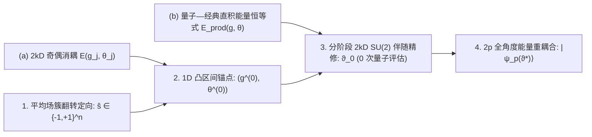
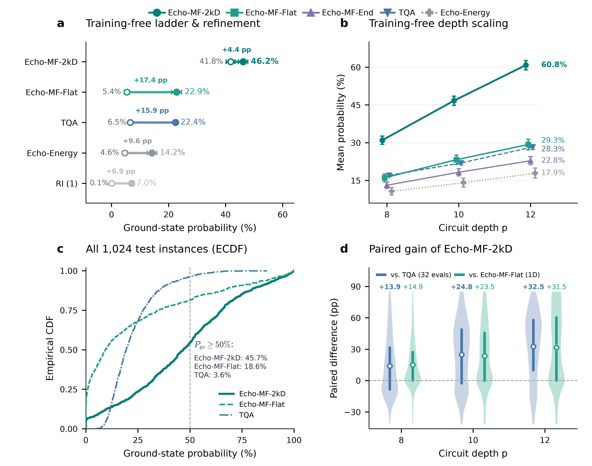
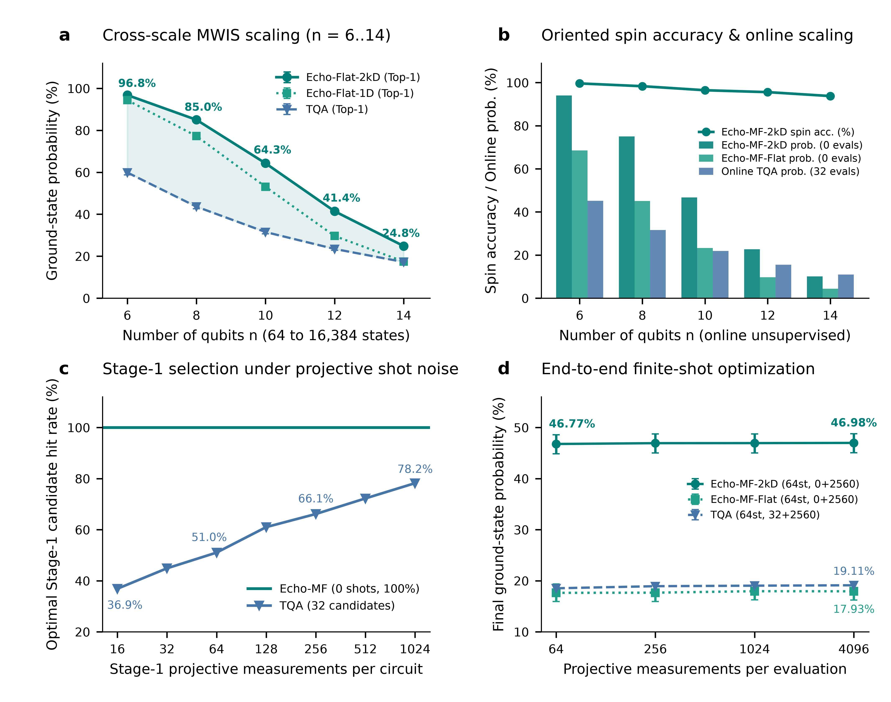

# 面向受约束变分量子优化的免训练平均场伴随流形初始化

## 摘要 (Abstract)

利用量子近似优化算法（QAOA）求解受约束组合优化问题，必须克服由局域外场与二次自旋耦合竞争诱导的崎岖能量景观。同质退火斜坡对所有量子比特施加统一相位，且需耗费数十次易受噪声干扰的在线量子测量筛选超参数；而热启动（Warm-Start）方案则修改线路架构，牺牲了全局脉冲硬件原生性。本文证明，在未修改的正偶数深度 $p=2k$ 标准全局 QAOA 线路中，反对称代价角配对与奇层自旋翻转可实现二次耦合项的 $2k$ 维奇偶消耦，确立多体量子期望能量与经典直积态能量的严格恒等式。利用该恒等式，我们提出免训练初始化器 `Echo-MF-2kD`，融合升温平均场簇翻转定向、Daubechies 最大平坦共振锚点与 $O(kn)$ 逆向 $\mathrm{SU}(2)$ 伴随流形精修。在 $n=10$ 的 1,024 道最大权独立集（MWIS）测试题及横跨 $n=6\text{--}14$ 的 5,120 道跨规模实例上，`Echo-MF-2kD` 无需阶段一测量，将特洛特化量子退火（TQA）的基态概率翻倍（$n=10$ 时 $46.16\%$ 对 $22.42\%$），减少 $45.2\%$ 的阶段二量子调用，并实现 $100\%$ 阶段一散粒噪声选点免疫。

## 引言 (Introduction)

受约束组合优化问题（如最大权独立集 MWIS）广泛出现于网络资源分配与统计物理中，可自然映射为 $n$ 个自旋 $s\in\{-1,+1\}^n$ 上的带场 Ising 哈密顿量 $H_C=H_J+H_h+C$（Lucas, 2014; Pichler et al., 2018; Ebadi et al., 2022）。在硬约束惩罚映射下，顶点度异构性诱导出强烈的逐点局域外场 $H_h=\sum_i h_i S_i$，与排斥性二次耦合 $H_J=\sum_{i<j} J_{ij} S_i S_j$ 剧烈竞争（Hadfield et al., 2019）。量子近似优化算法（QAOA）交替施加代价演化 $U_C(\gamma_\ell)=e^{-i\gamma_\ell H_C}$ 与全局横向场混合演化 $U_B(\beta_\ell)=e^{-i\beta_\ell\sum_i X_i}$，制备 $p$ 层态 $|\psi_p(\vartheta)\rangle=\prod_{\ell=1}^p U_B(\beta_\ell)U_C(\gamma_\ell)|+\rangle^{\otimes n}$（Farhi et al., 2014; Preskill, 2018; Cerezo et al., 2021; Blekos et al., 2024）。保持初态 $|+\rangle^{\otimes n}$ 与全局混合器 $U_B(\beta_\ell)$ 对超导处理器（Harrigan et al., 2021）、离子阱模拟器（Pagano et al., 2020）和里德堡原子阵列（Ebadi et al., 2022）至关重要，其中单一全局脉冲即可原生驱动全部比特。然而在固定深度 $p$ 下，$2p$ 维非凸能量景观包含指数级数量的次优极小值与对称分支（McClean et al., 2018; Shaydulin et al., 2019; Lotshaw et al., 2021; Shaydulin et al., 2021; You & Wu, 2021; Bittel & Kliesch, 2021; Anschuetz & Kiani, 2022）。由于每步参数移位梯度需 $O(p)$ 次电路执行及数千次测量采样（Mitarai et al., 2018; Wierichs et al., 2022），仅由 $(J,h)$ 计算高重叠起点 $\vartheta_0\in\mathbb R^{2p}$ 而不修改线路或耗费在线选点测量，是核心计算挑战。

在异构局域外场下，现有 QAOA 初始化方法面临结构性权衡。第一，同质退火日程——包括特洛特化量子退火（TQA）（Farhi et al., 2001; Kadowaki & Nishimori, 1998; Yang et al., 2017; Sack & Serbyn, 2021; Wurtz & Love, 2022）、逐层插值（INTERP）（Crooks, 2018; Zhou et al., 2020）与参数迁移（Brandao et al., 2018; Galda et al., 2021; Shaydulin et al., 2023）——对所有比特施加相同相位斜坡，无法分辨冲突边上的单比特自旋取向（Katial et al., 2025）；且在线 TQA 需数十次阶段一量子评估，易受散粒噪声误选（“赢家诅咒”）。第二，修改线路架构的半正定规划（SDP）热启动 `Warm-Start QAOA`（Bravyi et al., 2020; Egger et al., 2021; Tate et al., 2023）与多角 `ma-QAOA`（Herrman et al., 2022），或用定制旋转替换均匀混合器而丧失全局脉冲兼容性并诱发自旋冻结死区，或将参数维数膨胀至 $O(p(|V|+|E|))$ 导致高昂测量开销。第三，标准全局线路内的自旋回波奇偶消耦（Hahn, 1950; Carr & Purcell, 1954; Viola et al., 1999; Vandersypen & Chuang, 2005; Yao, 2026）将反对称代价角 $(-g_j,g_j)$ 与奇层翻转 $\beta_{2j-1}=\pi/2$ 配对，沿一维（1D）标量射线 $g_j=a r_j$ 抵消 $H_J$（Daubechies, 1988; Low et al., 2016; Low & Chuang, 2017; Gilyén et al., 2019; Yao, 2026）。但在无离线监督且 $n>2k$ 时，将全部 $k$ 对限制于单一标量 $a$ 会遭遇两道壁垒：（1）_丢番图频率拥塞_，单一标量无法同步对齐 $n>2k$ 个不可公度频率 $4h_i$；（2）_局部有效场反转_，弱极化比特在阶段二激活耦合时受排斥拉扯 $(J\boldsymbol{m})_i$，使其局部有效场 $h_i^{\mathrm{eff}}(\boldsymbol{m})=h_i+(J\boldsymbol{m})_i$ 符号反转。

为在不修改线路或调用量子测量的前提下克服这两道壁垒，我们注意到 $H_J$ 的奇偶消耦是对内代数恒等式而非一维特性。由于每个回波对独立通过全局翻转算符 $F=\prod_{i=1}^n X_i$ 共轭作用 $H_C$，当 $k$ 个代价半角 $\boldsymbol{g}\in\mathbb R^k$ 与 $k$ 个偶层混合角 $\boldsymbol{\theta}\in\mathbb R^k$ 自由变化时，$H_J$ 的精确抵消在整个 $2k$ 维完整对子流形上恒成立。在该 $2k$ 维流形上，$2p$ 层量子态严格分解为可由 $O(kn)$ 次经典 $2\times 2$ 运算求出的单比特态，且比特间统计独立性保证多体量子期望能量恒等于经典直积态能量：$\langle\psi_p(\boldsymbol{g},\boldsymbol{\theta})|H_C|\psi_p(\boldsymbol{g},\boldsymbol{\theta})\rangle \equiv E_{\mathrm{prod}}(\boldsymbol{g},\boldsymbol{\theta})$。该恒等式将量子初始化化归为 $\mathrm{SU}(2)^{\otimes n}$ 上可微的经典控制问题，在运行任何量子电路前即可通过 $E_{\mathrm{prod}}$ 与 $h_i^{\mathrm{eff}}(\boldsymbol{m})$ 预判多体耦合效应。

本文提出免训练、零量子选点的平均场多标量伴随乘积流形初始化框架（`Echo-MF-2kD`），直接将 $(J,h)$ 映射为标准 $2p$ 维全局 QAOA 角度。在正偶数深度 $p=2k$ 且局域外场非零（$h_i\ne 0$）条件下，我们证明 $2k$ 维完整对子流形保持精确直积分解与直积能量等价性，并在阶段二对称破缺微扰下保证 $H_J$ 的一阶线性重激活。算法上，`Echo-MF-2kD` 通过阻尼平均场升温延续与单边簇翻转将边排斥解析为自洽二值方向 $\hat{\boldsymbol{s}}\in\{-1,+1\}^n$，利用一维 Daubechies 响应在无零点区间上的严格凸性提取共振锚点，并在非退化混合角域内执行分阶段 $O(kn)$ 逆向 $\mathrm{SU}(2)$ 伴随精修以联合优化翻转敏感度加权对数似然、局部有效场防反转护栏与 $E_{\mathrm{prod}}$，最后接入阶段二全角度重耦合（Dupont et al., 2022）。在 $n=10$ 的 1,024 道留出 MWIS 实例、5,120 道跨规模实例（$n\in\{6,8,10,12,14\}$）及 2,750 道五家族基准题上，`Echo-MF-2kD` 在 $n=10$ 上将在线 TQA 基态概率翻倍（$46.16\%$ 对 $22.42\%$，$p=12$ 达 $60.80\%$），阶段一测量为 0，阶段二量子调用减少 $45.2\%$，并实现 $100\%$ 阶段一散粒噪声免疫。

---

## 结果 (Results)

### $2k$ 维自旋回波流形上的精确直积能量恒等式

**图 1 | `Echo-MF-2kD` 的理论机制与两阶段免训练架构。** **a**，将反对称代价角 $(-g_j, g_j)$ 与奇层自旋翻转 $U_B(\pi/2) \propto F$ 配对，可在自由变化的 $(g_j, \theta_j) \in \mathbb{R}^2$ 下于每一对内部独立抵消偶宇称 $H_J$。**b**，$2k$ 维子流形上的严格张量积分解使多体量子期望能量恒等于经典直积态能量 $E_{\mathrm{prod}}(\boldsymbol{g}, \boldsymbol{\theta})$。**c**，免训练在线部署通过升温平均场簇翻转将未见实例 $(J, h)$ 定向为 $\hat{\boldsymbol{s}} \in \{-1, +1\}^n$（1），提取一维 Daubechies 无零点凸区间共振锚点 $(\boldsymbol{g}^{(0)}, \boldsymbol{\theta}^{(0)})$（2），在非退化混合角边界与防反转护栏 $h_i^{\mathrm{eff}}(\boldsymbol{m})$ 下以零量子评估执行分阶段 $O(kn)$ $\mathrm{SU}(2)$ 伴随精修输出起点 $\vartheta_0 \in \mathbb{R}^{2p}$（3），并在第二阶段释放全部 $2p$ 个角度以重激活 $H_J$ 多体纠缠（4）。

在正偶数深度 $p=2k$ 的标准全局 QAOA 线路中，将第 $j$ 对相邻层（$2j-1$ 与 $2j$，$j=1,\ldots,k$）赋予反对称代价角 $(\gamma_{2j-1},\gamma_{2j})=(-g_j,g_j)$ 与三明治混合角 $(\beta_{2j-1},\beta_{2j})=(\pi/2,\theta_j)$，可使每一个奇层混合算符严格等于全局自旋翻转算符 $U_B(\pi/2)=(-i)^n F$（其中 $F=\prod_{i=1}^n X_i$）。由于二次自旋耦合在全局自旋反演下具有偶宇称（$FH_JF=H_J$），而局域外场具有奇宇称（$FH_hF=-H_h$），第 $j$ 对演化算符在差一个全局相位下恒等化简为 $E(g_j,\theta_j)=U_B(\theta_j)e^{-2ig_jH_h}F$（Yao, 2026）（见 Methods）。至关重要的是，这一算符抵消**在每一个完整回波对内部独立成立**，对不同对之间的参数 $(g_j,\theta_j)$ 不施加任何固定比例约束。因此，在整个 **$2k$ 维完整回波对参数子流形** $(\boldsymbol{g},\boldsymbol{\theta})=(g_1,\ldots,g_k,\theta_1,\ldots,\theta_k)\in[-10\pi,10\pi]^k\times[-\pi/2,\pi/2)^k$ 上，$2p$ 层量子线路的输出态严格分解为单比特量子态的张量直积 $|\psi_p(\boldsymbol{g},\boldsymbol{\theta})\rangle=\bigotimes_{i=1}^n u_i^{(k)}(\boldsymbol{g},\boldsymbol{\theta})$，其单比特正自旋概率 $p_i^+(\boldsymbol{g},\boldsymbol{\theta})=|u_{i,+}^{(k)}|^2$ 与磁化强度 $m_i(\boldsymbol{g},\boldsymbol{\theta})=2p_i^+-1\in[-1,1]$ 可通过 $k$ 步 $2\times 2$ 幺正矩阵递推在 $O(kn)$ 经典时间内精确算出。由于任意直积态中不同比特上的 Pauli-$Z$ 算符统计独立（当 $i\ne j$ 时 $\langle Z_i Z_j\rangle=m_i m_j$），$2k$ 维子流形上的多体量子期望能量恒等于经典直积态能量：

$$
\langle\psi_p(\boldsymbol{g},\boldsymbol{\theta})|H_C|\psi_p(\boldsymbol{g},\boldsymbol{\theta})\rangle \equiv E_{\mathrm{prod}}(\boldsymbol{g},\boldsymbol{\theta})=\frac12\boldsymbol{m}(\boldsymbol{g},\boldsymbol{\theta})^\top J\boldsymbol{m}(\boldsymbol{g},\boldsymbol{\theta})+\boldsymbol{h}^\top\boldsymbol{m}(\boldsymbol{g},\boldsymbol{\theta})+C.
$$

同时，在阶段二沿破缺反对称配对的方向将第 $j$ 对代价角微扰为 $(-g_j+\delta_j, g_j+\delta_j)$，可使对算符转化为 $U_B(\theta_j)e^{-2i\delta_j H_J}e^{-2ig_j H_h}F$，从而在一阶线性项上立即重新激活二次耦合演化 $H_J$，确保离开乘积流形时切向梯度非零（见 Methods）。

上述精确的量子—经典对应关系使我们无需执行任何量子电路运行，即可在经典处理器上优化全部 $2k$ 个自由度下的 $E_{\mathrm{prod}}(\boldsymbol{g},\boldsymbol{\theta})$ 与单比特相位对齐度（图 1）。本文框架（在线免训练模式记为 `Echo-MF-2kD`，离线已知目标分析记为 `Echo-Flat-2kD`）包含三个机制阶段（详见 Methods）：（1）_确定性升温平均场簇翻转定向_：沿递增逆温度日程延续阻尼平均场磁化强度并执行零温单边簇交换，将软边缘模糊性解析为自洽二值方向 $\hat{\boldsymbol{s}}\in\{-1,+1\}^n$；（2）_Daubechies 最大平坦凸区间锚点提取_：利用一维 Daubechies 负对数似然在无零点区间上的严格凸性，通过二分法提取共振锚点 $(\boldsymbol{g}^{(0)},\boldsymbol{\theta}^{(0)})$；（3）_分阶段 $O(kn)$ 逆向 $\mathrm{SU}(2)$ 伴随精修_：通过 $k$ 步 $2\times 2$ 旋量递推回传解析梯度（Step 1a 对齐 $k$ 个代价角 $\boldsymbol{g}$，Step 1b 在非退化混合角边界 $|\theta_j|\le \theta_{\max}<\pi/2$ 内联合精修 $(\boldsymbol{g},\boldsymbol{\theta})$），联合优化翻转敏感度加权对数似然、局部有效场防反转护栏与 $E_{\mathrm{prod}}$。

**表 1 | 未见 MWIS 测试集上从 1D 标量扫描到带护栏分阶段 $2k$D 流形精修的渐进组件消融。** 表中报告固定深度 $p=10$（$k=5$ 对）下横跨 $n\in\{8,10,12\}$（每规模 1,024 道未见测试题）的平均初始 $\rightarrow$ 优化后基态概率 $P_{\mathrm{gs}}^{\mathrm{init}} \rightarrow P_{\mathrm{gs}}^{\mathrm{final}}$（%，附 4,000 次重采样 bootstrap 95% 置信区间）及阶段一全比特象限命中率（$\forall i:h_i\ne 0, \pi_i>0.50$；%，括号内）。离线已知目标模式（`Echo-Flat-*`）与在线免训练模式（`Echo-MF-*`，仅输入 $(J,h)$ 且阶段一量子评估为 0）共享一致的阶段二 L-BFGS-B 设置。粗体表示各模式内的最优最终基态概率。

| 模式     | 消融变体                      | 流形与物理护栏配置                            |                           $n = 8$                            |                           $n = 10$                           |                           $n = 12$                           |
| :------- | :---------------------------- | :-------------------------------------------- | :----------------------------------------------------------: | :----------------------------------------------------------: | :----------------------------------------------------------: |
| **离线** | **Echo-Flat-1D**              | 1D 标量 $a$（凸区间二分寻根）                 |     $33.19 \rightarrow 77.25^{+1.36}_{-1.34}$ ($46.0$)       |     $13.07 \rightarrow 53.08^{+1.51}_{-1.57}$ ($18.8$)       |      $3.69 \rightarrow 29.64^{+1.33}_{-1.25}$ ($4.4$)        |
|          | **Echo-Flat-kD** (Cost-Only)  | $k$D 代价角 $\boldsymbol{g}$（无护栏 NLL）    |     $35.02 \rightarrow 78.47^{+1.19}_{-1.23}$ ($69.0$)       |     $15.17 \rightarrow 55.73^{+1.37}_{-1.38}$ ($37.7$)       |     $4.91 \rightarrow 33.63^{+1.22}_{-1.14}$ ($17.3$)        |
|          | **Echo-Flat-kD** (Guarded)    | $k$D 代价角 $\boldsymbol{g}$ + 护栏 + $E_{\mathrm{prod}}$ |     $33.05 \rightarrow 78.35^{+1.21}_{-1.24}$ ($49.3$)       |     $13.66 \rightarrow 54.79^{+1.47}_{-1.49}$ ($22.7$)       |      $4.09 \rightarrow 32.50^{+1.19}_{-1.22}$ ($6.5$)        |
|          | **Echo-Flat-2kD** (Unconstr.) | $2k$D $(\boldsymbol{g},\boldsymbol{\theta})$（无护栏） |     $71.52 \rightarrow 84.53^{+0.94}_{-0.95}$ ($94.4$)       |     $45.45 \rightarrow 64.03^{+1.20}_{-1.25}$ ($88.8$)       |     $23.40 \rightarrow 41.36^{+1.19}_{-1.19}$ ($77.8$)       |
|          | **Echo-Flat-2kD**             | 分阶段 $2k$D + 护栏 + $E_{\mathrm{prod}}$     | $70.89 \rightarrow \mathbf{85.01}^{+0.92}_{-0.93}$ ($94.0$)  | $44.31 \rightarrow \mathbf{64.29}^{+1.22}_{-1.24}$ ($86.4$)  | $22.87 \rightarrow \mathbf{41.41}^{+1.18}_{-1.15}$ ($75.0$)  |
| **在线** | **Echo-MF-Flat** (1D)         | 平均场软边缘 + 1D 重叠解码                    |     $15.96 \rightarrow 45.11^{+2.41}_{-2.40}$ ($0.0$)        |      $5.39 \rightarrow 23.23^{+1.83}_{-1.92}$ ($0.0$)        |      $1.26 \rightarrow 9.74^{+1.21}_{-1.12}$ ($0.0$)         |
|          | **Echo-MF-kD** (Soft, Cost)   | 平均场软边缘 + 无护栏 $k$D $\boldsymbol{g}$   |     $21.08 \rightarrow 46.96^{+2.36}_{-2.35}$ ($73.2$)       |     $8.16 \rightarrow 23.83^{+1.82}_{-1.77}$ ($39.6$)        |     $2.51 \rightarrow 9.65^{+1.08}_{-1.04}$ ($22.0$)         |
|          | **Echo-MF-kD** (Guarded)      | 簇翻转定向 $\hat{\boldsymbol{s}}$ + 带护栏 $k$D $\boldsymbol{g}$ |     $32.47 \rightarrow 61.64^{+2.17}_{-2.26}$ ($49.2$)       |     $13.03 \rightarrow 31.58^{+1.99}_{-1.96}$ ($22.5$)       |      $3.89 \rightarrow 12.31^{+1.27}_{-1.26}$ ($6.3$)        |
|          | **Echo-MF-2kD** (Unconstr.)   | 簇翻转定向 $\hat{\boldsymbol{s}}$ + 无护栏 $2k$D |     $70.03 \rightarrow 74.69^{+1.64}_{-1.69}$ ($94.3$)       | $43.20 \rightarrow \mathbf{46.75}^{+1.77}_{-1.85}$ ($88.8$)  |     $21.88 \rightarrow 22.39^{+1.30}_{-1.35}$ ($77.9$)       |
|          | **Echo-MF-2kD**               | 簇翻转定向 $\hat{\boldsymbol{s}}$ + 分阶段 $2k$D | $69.41 \rightarrow \mathbf{74.99}^{+1.65}_{-1.68}$ ($93.8$)  |     $42.20 \rightarrow 46.70^{+1.78}_{-1.90}$ ($86.8$)       | $21.38 \rightarrow \mathbf{22.64}^{+1.31}_{-1.38}$ ($75.0$)  |

横跨 5,120 道未见 MWIS 实例的受控消融实验证实了各物理机制的独立作用（表 1）。首先，在在线无监督模式下，拟合未定向的平均场软边缘（`Echo-MF-kD (Soft, Cost-Only)`）在 $n=10$ 与 $n=12$ 上停滞于 $23.83\%$ 与 $9.65\%$，因为 $\pi_i^{\mathrm{mf}}\approx 0.5$ 的受挫顶点会将优化拉向互斥的独立集分支。引入确定性升温簇翻转定向与有效场防反转护栏（`Echo-MF-kD (Guarded)`）后，单比特自旋方向准确率从 $85.03\%\text{--}89.18\%$ 升至 $93.75\%\text{--}99.61\%$，使 $n=8,10$ 的在线最终概率提高 $+14.68$ 与 $+7.75$ 个百分点（pp）。其次，当系统规模超越回波对数（$n\ge 10 > k=5$）时，仅调节 $k=5$ 个代价角而冻结 1D Daubechies 混合角（`Echo-Flat-kD` 与 `Echo-MF-kD`）无法解除丢番图频率拥塞，将 $n=12$ 的初始直积态概率限制在 $3.89\%\text{--}4.91\%$、全比特象限命中率限制在 $6.3\%\text{--}17.3\%$。在 Step 1b 中释放全部 $2k=10$ 个参数（`Echo-Flat-2kD` 与 `Echo-MF-2kD`）使 $n=12$ 的初始直积态概率提升逾 5 倍至 $21.38\%\text{--}22.87\%$，象限命中率升至 $75.0\%$（$n=10$ 上达 $86.4\%\text{--}86.8\%$）。第三，施加非退化混合角边界与分阶段防反转护栏取得了最优跨规模表现（`Echo-Flat-2kD` 在 $n=8,10,12$ 上达 $\mathbf{85.01}\%, \mathbf{64.29}\%, \mathbf{41.41}\%$；在线 `Echo-MF-2kD` 在 $n=6\text{--}14$ 上达 $\mathbf{94.02}\%, \mathbf{74.99}\%, \mathbf{46.70}\%, \mathbf{22.64}\%, \mathbf{10.13}\%$），较 1D `Echo-MF-Flat` 净赢 $+5.81\text{--}+29.88$ pp，并将阶段二量子梯度调用从 $102.3\text{--}122.5$ 次削减至 $\mathbf{61.3\text{--}79.3}$ 次。

---

### 基态成功概率翻倍且量子搜索开销减半

**图 2 | 在留出 MWIS 中心测试集（$n=10$，1,024 道未见实例）上，`Echo-MF-2kD` 将在线 TQA 的最终基态概率翻倍以上，同时将阶段二量子梯度调用削减近半。** **a**，跨深度（$p\in\{8,10,12\}$）实例平均的阶段一初始直积态基态概率 $P_{\mathrm{gs}}^{(0)}$ 与阶段二优化后最终基态概率 $P_{\mathrm{gs}}$。**b**，最终平均基态概率随电路深度 $p=8,10,12$ 的扩展曲线；误差棒表示 4,000 次重采样非参数百分位 bootstrap 95% 置信区间。**c**，全部 1,024 道测试题上跨深度平均最终基态概率的经验累积分布函数（ECDF），标出高成功概率实例覆盖率（$P_{\mathrm{gs}}\ge 50\%$）。**d**，各电路深度下 `Echo-MF-2kD` 相对 32 次量子选点在线 TQA 及 1D `Echo-MF-Flat` 的逐题配对净概率增益（$\Delta P_{\mathrm{gs}}$，单位：百分点）。

**表 2 | 留出 MWIS 中心测试集（$n=10$，1,024 道未见实例）上各阶段量子评估开销与初始至最终基态概率对比。** 所有方法仅接收 $(J,h)$（0 训练数据）并接入一致的阶段二 L-BFGS-B 优化器，依次分为无先验/同质启发式、1D 平均场重叠解码与分阶段 $2k$D 伴随精修（`Echo-MF-2kD`）。表中报告阶段一量子评估数、跨深度（$p\in\{8,10,12\}$）平均阶段二梯度量子调用数（`Echo-MF-2kD` 分深度为 $46.7/63.6/84.1$，对比 `Echo-MF-Flat` 的 $71.6/102.5/125.1$ 与 `TQA` 的 $99.7/121.0/134.2$）、初始 $\rightarrow$ 最终概率（$P_{\mathrm{gs}}^{(0)} \rightarrow P_{\mathrm{gs}}$，%，附 95% 置信区间）及相对 `TQA` 的配对净增益。粗体标出每列最优值。

| 方法             | 阶段一 评估 | 阶段二 调用 |                      $p = 8$                       |                      $p = 10$                      |                      $p = 12$                      | 跨深度均值 (%)           | 相对 TQA 净增益 (pp)               |
| :--------------- | :------------: | :------------: | :------------------------------------------------: | :------------------------------------------------: | :------------------------------------------------: | :-------------------------: | :-----------------------------------: |
| **RI (1)**       |      $0$       |    $125.2$     |       $0.10 \rightarrow 3.84^{+0.60}_{-0.57}$       |       $0.10 \rightarrow 6.82^{+0.90}_{-0.87}$       |      $0.10 \rightarrow 10.42^{+1.23}_{-1.20}$       |    $0.10 \rightarrow 7.03$    |     $-15.39\ ([-16.18, -14.65])$      |
| **RI (32)**      |      $32$      |    $134.0$     |       $0.22 \rightarrow 6.47^{+0.62}_{-0.60}$       |       $0.20 \rightarrow 9.93^{+0.87}_{-0.81}$       |      $0.17 \rightarrow 12.81^{+1.02}_{-0.97}$       |    $0.20 \rightarrow 9.73$    |     $-12.69\ ([-13.41, -11.98])$      |
| **Echo-Energy**  |      $0$       |     $93.0$     |      $4.34 \rightarrow 10.68^{+1.54}_{-1.48}$       |      $4.70 \rightarrow 14.09^{+1.77}_{-1.75}$       |      $4.91 \rightarrow 17.86^{+2.03}_{-1.94}$       |   $4.65 \rightarrow 14.21$    |       $-8.21\ ([-9.88, -6.47])$       |
| **TQA**          |      $32$      |    $118.3$     |      $4.60 \rightarrow 17.05^{+0.56}_{-0.56}$       |      $6.81 \rightarrow 21.94^{+0.68}_{-0.68}$       |      $8.23 \rightarrow 28.27^{+0.92}_{-0.91}$       |   $6.55 \rightarrow 22.42$    |             基准 ($0.00$)             |
| **Echo-MF-Alt**  |      $0$       |    $117.6$     |       $3.00 \rightarrow 8.53^{+0.84}_{-0.82}$       |      $2.73 \rightarrow 13.53^{+1.18}_{-1.22}$       |      $2.77 \rightarrow 18.65^{+1.47}_{-1.58}$       |   $2.83 \rightarrow 13.57$    |       $-8.85\ ([-9.72, -7.98])$       |
| **Echo-MF-End**  |      $0$       |    $120.1$     |      $4.43 \rightarrow 13.10^{+1.25}_{-1.23}$       |      $4.44 \rightarrow 18.24^{+1.43}_{-1.42}$       |      $4.45 \rightarrow 22.83^{+1.65}_{-1.57}$       |   $4.44 \rightarrow 18.06$    |       $-4.36\ ([-5.61, -3.11])$       |
| **Echo-MF-Flat** |  $\mathbf{0}$  |     $99.8$     |      $5.13 \rightarrow 16.05^{+1.52}_{-1.56}$       |      $5.39 \rightarrow 23.23^{+1.83}_{-1.92}$       |      $5.69 \rightarrow 29.28^{+2.08}_{-2.17}$       |   $5.40 \rightarrow 22.85$    |       $+0.43\ ([-1.26, +2.08])$       |
| **Echo-MF-2kD**  |  $\mathbf{0}$  | $\mathbf{64.8}$ | $\mathbf{29.28} \rightarrow \mathbf{30.98}^{+1.67}_{-1.68}$ | $\mathbf{42.20} \rightarrow \mathbf{46.70}^{+1.78}_{-1.90}$ | $\mathbf{53.85} \rightarrow \mathbf{60.80}^{+1.82}_{-1.91}$ | $\mathbf{41.77} \rightarrow \mathbf{46.16}$ | $\mathbf{+23.74}\ ([+22.06, +25.43])$ |

在全部 1,024 道留出 MWIS 中心测试题（$n=10, p\in\{8,10,12\}$）上，`Echo-MF-2kD` 化解了精度—效率权衡，跨深度平均最终基态概率达 $\mathbf{46.16}\%$（$p=8,10,12$ 下为 $\mathbf{30.98}\%, \mathbf{46.70}\%, \mathbf{60.80}\%$），较 32 次选点在线 `TQA`（$22.42\%$）净增 $\mathbf{+23.74}$ pp（$2.06$ 倍 `TQA`），较 `RI (32)`（$9.73\%$）净增 $+36.43$ pp（$4.74$ 倍），较 1D `Echo-MF-Flat`（$22.85\%$）净增 $+23.31$ pp（图 2a, b 与表 2）。在未执行任何量子电路评估前，`Echo-MF-2kD` 制备的阶段一经典直积态平均初始概率 $P_{\mathrm{gs}}^{(0)}$ 已达 $\mathbf{41.77}\%$（$p=12$ 时达 $\mathbf{53.85}\%$）——是 `TQA` 经 32 次选点与 118.3 步梯度优化后*最终概率*的 $1.86$ 倍。在实例级 ECDF 中（图 2c, d），`Echo-MF-2kD` 相对 `TQA` 的单题胜率达 $60.8\%\text{--}80.6\%$（配对净增益 $+13.93\text{--}+32.53$ pp），并将高概率实例覆盖率（$P_{\mathrm{gs}}\ge 50\%$）提升至 $\mathbf{45.7}\%$，远超 `TQA` 的 $3.6\%$（$12.7$ 倍）与 `Echo-MF-Flat` 的 $18.6\%$（$2.5$ 倍）。

从动力学机理看，求解质量与搜索速度的同步跃升源于 $2k$ 维乘积流形在真实基态吸引盆内完成了单比特相位预对齐。由于同质 `TQA` 斜坡与随机起点远离异构基态（$P_{\mathrm{gs}}^{(0)}$ 仅 $4.60\%\text{--}8.23\%$ 与 $0.17\%\text{--}0.22\%$），其阶段二 L-BFGS-B 轨迹必须穿越崎岖非凸山脊，平均消耗 $118.3$ 与 $134.0$ 次梯度量子评估。反观 `Echo-MF-2kD`，其以 $96.45\%$ 的单比特准确率（整题命中率 $94.92\%$）锁定目标自旋取向，并在 $p=8,10,12$ 下将 $76.8\%, 86.8\%, 91.0\%$ 的实例直接置入全比特目标象限。从目标吸引盆深处出发，阶段二 L-BFGS-B 仅需微调局部耦合，以 $\mathbf{46.7, 63.6, 84.1}$ 次梯度评估收敛（均值 $\mathbf{64.8}$——较 `TQA` 减少 $\mathbf{45.2}\%$，较 `RI (32)` 减少 $51.6\%$，较 `Echo-MF-Flat` 减少 $35.1\%$）。此外，不同于修改线路的 `Warm-Start QAOA`（Egger et al., 2021; Tate et al., 2023）或参数膨胀的 `ma-QAOA`（Herrman et al., 2022）（在 $n=10, p=10$ 下需多耗费 $38$ 倍参数移位电路运行），`Echo-MF-2kD` 严格运行于未修改的 $2p$ 参数全局 QAOA 线路中。

---

### 横跨 5,120 道实例与五类 Ising 家族的跨尺度扩展规律

**图 3 | 横跨 5,120 道 MWIS 测试题（$n\in\{6,8,10,12,14\}$）的跨尺度扩展规律与投影测量散粒噪声免疫。** **a**，MWIS 问题在固定电路深度 $p=10$（$k=5$ 对）下从 $n=6$ 至 $n=14$（希尔伯特空间从 $64$ 维扩展至 $16{,}384$ 维，每规模 1,024 道未见实例）的无截断同候选数（Top-1）离线扩展曲线，对比 `Echo-Flat-2kD`、`Echo-Flat-1D` 与 `TQA`。**b**，同一批 5,120 道测试题上的在线免训练扩展表现，展示 `Echo-MF-2kD` 的单比特自旋定向准确率（上方折线）及其在 0 次量子选点下对决 32 次选点在线 `TQA` 与 1D `Echo-MF-Flat` 的最终基态概率（下方柱状图）。**c**，阶段一选点散粒噪声测试（$n=10, p=10$，1,024 题），对比 `TQA` 在 $N_{\mathrm{shots}}\in\{16,32,64,128,256,512,1024\}$ 下命中无噪最优步长的比例与零量子测量 `Echo-MF`（恒为 $100\%$）。**d**，端到端有限采样参数移位变分优化（$n=10, p=10$，1,024 题，64 步，$N_{\mathrm{shots}}\in\{64,256,1024,4096\}$）。所有误差棒与阴影带均表示 4,000 次重采样 bootstrap 95% 置信区间。

**表 3 | 固定深度 $p=10$ 下横跨 $n\in\{6,8,10,12,14\}$ 的大样本跨规模 MWIS 评测（每规模 1,024 道未见测试题，共 5,120 题）。** **a**，离线无截断同候选数（Top-1 与 Top-2）最终基态概率（%）及 `Echo-Flat-2kD` 相对 `TQA` 的配对净增益。**b**，同一批 5,120 道实例上在线免训练 `Echo-MF-2kD`（0 次阶段一量子评估）与 1D `Echo-MF-Flat` 对决在线 `TQA`（32 次阶段一量子评估）的单比特自旋定向准确率（%）、初始 $\rightarrow$ 最终基态概率（%）及阶段二平均含梯度量子调用次数。粗体标出各对比组最优值。

**a. 离线同候选数扩展（无截断自然收敛，已知目标态）**

| 规模 $n$ | Echo-Flat-1D (Top-1) |    Echo-Flat-2kD (Top-1)      |    Echo-Flat-2kD (Top-2)      |        TQA (Top-1 / Top-2)         | 相对 TQA 净增益 (Top-1, pp)        |
| :------: | :---------------------: | :------------------------------: | :------------------------------: | :-----------------------------------: | :-----------------------------------: |
|   $6$    | $94.37^{+0.69}_{-0.73}$ | $\mathbf{96.79}^{+0.48}_{-0.53}$ | $\mathbf{97.44}^{+0.39}_{-0.42}$ | $59.88^{+1.14}_{-1.13}\ /\ 62.18^{+1.15}_{-1.15}$ | $\mathbf{+36.91}\ ([+35.74, +38.02])$ |
|   $8$    | $77.25^{+1.36}_{-1.34}$ | $\mathbf{85.01}^{+0.92}_{-0.93}$ | $\mathbf{87.18}^{+0.83}_{-0.81}$ | $43.62^{+1.07}_{-1.02}\ /\ 45.53^{+1.08}_{-1.04}$ | $\mathbf{+41.39}\ ([+40.10, +42.72])$ |
|   $10$   | $53.08^{+1.51}_{-1.57}$ | $\mathbf{64.29}^{+1.22}_{-1.24}$ | $\mathbf{67.41}^{+1.13}_{-1.14}$ | $31.52^{+0.82}_{-0.84}\ /\ 33.06^{+0.86}_{-0.90}$ | $\mathbf{+32.76}\ ([+31.35, +34.17])$ |
|   $12$   | $29.64^{+1.33}_{-1.25}$ | $\mathbf{41.41}^{+1.18}_{-1.15}$ | $\mathbf{45.51}^{+1.10}_{-1.11}$ | $23.45^{+0.69}_{-0.66}\ /\ 24.48^{+0.69}_{-0.67}$ | $\mathbf{+17.96}\ ([+16.75, +19.16])$ |
|   $14$   | $17.47^{+0.96}_{-0.96}$ | $\mathbf{24.84}^{+0.95}_{-0.93}$ | $\mathbf{27.86}^{+0.95}_{-0.91}$ | $17.23^{+0.58}_{-0.53}\ /\ 18.16^{+0.62}_{-0.57}$ |  $\mathbf{+7.61}\ ([+6.66, +8.57])$   |

**b. 在线免训练扩展（仅输入 $(J, h)$，目标态未知）**

| 规模 $n$ | 定向准确率 (%) |     Echo-MF-Flat (1D, 0 evals)      |        Echo-MF-2kD ($2k$D, 0 evals)          |        Online TQA (32 evals)        | 阶段二调用 (Echo-MF-2kD / TQA)    |
| :------: | :---------------: | :------------------------------------: | :---------------------------------------------: | :------------------------------------: | :----------------------------------: |
|   $6$    |      $99.61$      | $36.16 \rightarrow 68.49^{+2.34}_{-2.48}$ | $91.00 \rightarrow \mathbf{94.02}^{+0.96}_{-1.06}$ | $20.71 \rightarrow 45.19^{+1.15}_{-1.14}$ |       $\mathbf{79.3}\ /\ 129.0$       |
|   $8$    |      $98.32$      | $15.96 \rightarrow 45.11^{+2.41}_{-2.40}$ | $69.41 \rightarrow \mathbf{74.99}^{+1.65}_{-1.68}$ | $12.07 \rightarrow 31.64^{+0.95}_{-0.93}$ |       $\mathbf{68.6}\ /\ 121.7$       |
|   $10$   |      $96.45$      |  $5.39 \rightarrow 23.23^{+1.83}_{-1.92}$ | $42.20 \rightarrow \mathbf{46.70}^{+1.78}_{-1.90}$ |  $6.81 \rightarrow 21.94^{+0.68}_{-0.68}$ |       $\mathbf{63.6}\ /\ 121.0$       |
|   $12$   |      $95.57$      |  $1.26 \rightarrow 9.74^{+1.21}_{-1.12}$  | $21.38 \rightarrow \mathbf{22.64}^{+1.31}_{-1.38}$ |  $3.88 \rightarrow 15.55^{+0.54}_{-0.50}$ |       $\mathbf{62.6}\ /\ 119.6$       |
|   $14$   |      $93.75$      |  $0.46 \rightarrow 4.32^{+0.70}_{-0.66}$  | $\mathbf{10.12} \rightarrow 10.13^{+0.93}_{-0.90}$ | $2.17 \rightarrow \mathbf{10.94}^{+0.44}_{-0.40}$ |       $\mathbf{61.3}\ /\ 119.8$       |

在固定深度 $p=10$（$2k=10$ 个流形参数）下评测横跨 $n\in\{6,8,10,12,14\}$ 的 5,120 道未见 MWIS 实例，揭示了 $2k$ 维精修如何重塑超完备区间（$n>2k$）的扩展规律（图 3a, b 与表 3）。在离线同候选数对比中（表 3a），一维 `Echo-Flat-1D (Top-1)` 在 $n\ge 12 > 2k$ 时遭遇严重丢番图频率拥塞，初始直积态概率跌至 $3.69\%$（$n=12$）与 $1.29\%$（$n=14$）。在 `Echo-Flat-2kD` 中解锁全部 $2k=10$ 个对内自由度，将超完备区间的初始直积态概率提升 $6.2\text{--}8.6$ 倍（$n=12,14$ 上达 $22.87\%$ 与 $11.08\%$）。经阶段二重耦合后，`Echo-Flat-2kD (Top-1)` 在全部五个规模上均击败 `TQA (Top-1)` 与 `Echo-Flat-1D (Top-1)`，相对 `TQA` 的配对净增益达 $\mathbf{+36.91}, \mathbf{+41.39}, \mathbf{+32.76}, \mathbf{+17.96}, \mathbf{+7.61}$ pp（在 $n=10,12,14$ 上达 $\mathbf{64.29}\% / \mathbf{67.41}\%$、$\mathbf{41.41}\% / \mathbf{45.51}\%$ 与 $\mathbf{24.84}\% / \mathbf{27.86}\%$ 的 Top-1 / Top-2 概率，所有 95% 置信区间严格大于零）。

在在线免训练模式下（表 3b），一维软边缘重叠解码（`Echo-MF-Flat`）在 $n\le 10$ 时优于 `TQA`，但在 $n=12, 14$ 时因未定向软边缘叠加一维频率拥塞而坍缩（$9.74\%, 4.32\%$）。反观 `Echo-MF-2kD` 的升温簇翻转定向，在全部 5,120 道实例上保持 $93.75\%\text{--}99.61\%$ 的单比特方向准确率。在零阶段一测量下，`Echo-MF-2kD` 在 $n=6,8,10,12$ 上达 $\mathbf{94.02}\%, \mathbf{74.99}\%, \mathbf{46.70}\%, \mathbf{22.64}\%$，较 32 次选点在线 `TQA` 净赢 $\mathbf{+48.83}, \mathbf{+43.35}, \mathbf{+24.76}, \mathbf{+7.09}$ pp，同时将阶段二量子梯度调用削减约一半（$\mathbf{61.3\text{--}79.3}$ 对 $119.6\text{--}129.0$）。在冲突惩罚（$Q=2\max_i v_i$）使激发态能垒陡峭的 $n=14$ 上，`Echo-MF-2kD` 零测量的阶段一经典直积态（$\mathbf{10.12}\%$，为 `TQA` 初始态 $2.17\%$ 的 $4.7$ 倍、`Echo-MF-Flat` 初始态 $0.46\%$ 的 $22$ 倍）已直接追平在线 `TQA` 优化后的最终概率（$10.94\%$）。

这一跨尺度机制延伸至五类标准 Ising 基准家族（`MWIS`、`Dense Ising`、`Sparse Ising`、`Grid Ising` 与 `Pinned MaxCut`；Yao, 2026）在 $n=11, 12$（$p=10$，500 道实例）的无截断边界实验（Extended Data Table 1）。`Echo-Flat-2kD` 在异构外场 `MWIS` 上较 `Echo-Flat-1D` 净增 $+12.05$ 与 $+10.57$ pp（达 $\mathbf{56.69}\%$ 与 $\mathbf{41.66}\%$，较 `TQA` 净赢 $\mathbf{+28.81}$ 与 $\mathbf{+16.56}$ pp），将零均值高斯外场 `Dense`、`Sparse` 与 `Grid Ising` 的阶段一初始直积态概率从 $5.05\%\text{--}9.12\%$（`Echo-Flat-1D`）推高至 $24.70\%\text{--}37.47\%$，并全面超越全部四个非零外场家族上的在线 `TQA`。反之，在内部局域外场恒为零（$h_i=0$）的负对照家族 `Pinned MaxCut` 上，1D 与 $2k$D 初始概率均严格受制于 $2^{-n_0}$（$0.20\%\text{--}0.37\%$），印证了完整回波对演化由非零局域外场 $H_h$ 驱动的理论前提。

---

### 投影测量散粒噪声免疫与早停采样效率

在真实量子硬件运行中，投影测量在每次能量评估中引入尺度为 $O(N_{\mathrm{shots}}^{-1/2})$ 的多项分布散粒噪声。在全部 1,024 道留出 MWIS 中心测试题（$n=10, p=10$）上，在线 `TQA` 从 32 个候选步长中挑选经验最低能量点时遭受严重的阶段一“赢家诅咒”误选（图 3c 与 Extended Data Table 2）：在 $N_{\mathrm{shots}}=16, 32, 64$ 下，统计涨落将 `TQA` 的无噪最优命中率限制在 $36.86\%, 44.86\%, 51.02\%$，在 $N_{\mathrm{shots}}=1024$ 下亦仅为 $78.20\%$。由于 `Echo-MF-2kD` 与 `Echo-MF-Flat` 纯靠经典处理器以零量子测量确定性执行阶段一流形精修，其阶段一选点在所有采样预算下对散粒噪声 $100\%$ 免疫。

当阶段一选点与阶段二 64 步参数移位梯度优化（每步 $2\times 2p=40$ 次电路运行）运行于有限采样 $N_{\mathrm{shots}}\in\{64,256,1024,4096\}$ 下时，`Echo-MF-2kD` 展现出显著的测量节省与抗噪优势（图 3d 与 Extended Data Table 2）。在零量子测量（0 步）下，`Echo-MF-2kD` 的经典初始直积态（$\mathbf{42.20}^{+1.55}_{-1.70}\%$）已超过 64 步含噪 `TQA` 最终概率（$2{,}592$ 次电路评估后为 $18.52\%\text{--}19.11\%$）的 $2.2$ 倍。在 16 步早停（$640$ 次评估，节省 $75.3\%$ 采样数）与 32 步早停（$1{,}280$ 次评估，节省 $50.6\%$ 采样数）下，`Echo-MF-2kD` 达 $44.03\%\text{--}44.73\%$ 与 $45.60\%\text{--}46.28\%$，较 64 步 `TQA` 净赢 $\mathbf{+25.51\text{--}+25.62}$ pp 与 $\mathbf{+27.08\text{--}+27.20}$ pp。在 64 步（$2{,}560$ 次评估）下，`Echo-MF-2kD` 达 $\mathbf{46.77}\%\text{--}\mathbf{46.98}\%$，较 `TQA` 配对净赢 $\mathbf{+27.87\text{--}+28.25}$ pp。

---

## 讨论 (Discussion)

通过证明二次耦合项 $H_J$ 的自旋回波奇偶消耦可从一维标量射线扩展至未修改深度 $2k$ 标准全局 QAOA 线路内部的整个 $2k$ 维完整对子流形，本研究确立了多体量子期望能量与经典直积态能量的严格恒等式：$\langle\psi_p(\boldsymbol{g},\boldsymbol{\theta})|H_C|\psi_p(\boldsymbol{g},\boldsymbol{\theta})\rangle \equiv E_{\mathrm{prod}}(\boldsymbol{g},\boldsymbol{\theta})$。这一结构洞察化解了硬件原生线路执行与逐点异构相位初始化之间的长期矛盾：无需像热启动方案那样用逐比特异构混合器修改量子线路架构（Egger et al., 2021; Tate et al., 2023），也无需在同质退火网格上耗费在线量子测量（Sack & Serbyn, 2021），`Echo-MF-2kD` 利用隐藏在标准线路内部的可积 $2k$ 维直积子流形，纯靠经典计算即可完成异构单比特相位对齐并平抑有效场反转，随后再无缝交由全角度量子演化激活多体纠缠。

超越 QAOA 本身，本文确立的三阶段物理分工——经典平均场拓扑定向、嵌入式对称消耦直积流形上的精确伴随控制、以及对称破缺多体重耦合（Dupont et al., 2022）——为参数化量子线路与多体变分模拟提供了普适的方法论蓝图。只要目标哈密顿量能够在某种硬件原生全局对称操作（如自旋晶格中的全局 Pauli 翻转或费米子系统中的粒子—空穴共轭）下分解为奇偶对立的两部分，在深层变分线路中插入对称支点即可开辟出一个经典可精确求解的低维子流形。利用 $O(kn)$ 逆向 $\mathrm{SU}(2)$ 伴随微分在该精确子流形上预优化经典代理能量与局部稳定性护栏，不仅规避了荒漠高地（barren plateaus）与散粒噪声误选，还将经典预处理复杂度从半正定规划的 $O(n^{3.5})$ 降至稀疏图线性复杂度 $O(T_{\mathrm{mf}}|E|+kn)$。

我们的理论假设与跨家族实验同样清晰界定了两项适用边界。第一，由于完整回波对子流形上的单比特相位演化 $e^{-2ig_jH_h}$ 完全由局域外场 $H_h$ 驱动，对于局域外场恒为零（$h=0$，如无权最大割或 `Pinned MaxCut` 的内部顶点）的纯二次耦合问题，纯回波流形不产生比特间相位分化；将 `Echo-MF-2kD` 推广至无场图问题，需先通过钉扎参考顶点或施加单层平均场对称破缺来诱导有效局域外场。第二，当系统规模进入深超完备区间（$n=14 > 2k=10$）且伴随强约束惩罚（$Q=2\max_i v_i$）时，尽管 `Echo-MF-2kD` 零量子测量的阶段一直积态（$10.12\%$）已匹敌在线 `TQA` 优化后的最终概率（$10.94\%$），但在阶段二直接最小化期望能量 $\langle H_C\rangle$ 会优先压制高惩罚激发态长尾而非推高基态峰值（$10.12\%\to 10.13\%$）。将阶段二期望能量目标替换为聚焦低能尾部的条件风险价值（CVaR）目标，或在中性里德堡原子阵列上令线路深度随系统规模线性扩展（$p\propto n$），将为百比特级受约束变分量子优化提供直接路径。

---

## 方法 (Methods)

### 问题形式化与理论预备 (Problem Formulation and Theoretical Preliminaries)

**归一化 Ising 哈密顿量与标准全局 QAOA 架构。** 考虑定义在 $n$ 个自旋变量 $s\in\{-1,+1\}^n$（与二值变量通过 $x_i=(1+s_i)/2\in\{0,1\}$ 映射）上的带局域外场 Ising 能量函数：

$$
E(s)=\frac12s^\top Js+h^\top s+C,\qquad s\in\{-1,+1\}^n,
$$

其中 $J\in\mathbb R^{n\times n}$ 对称且对角线为零，$h\in\mathbb R^n$ 为局域外场向量。为在不改变能级严格序关系与能隙比值的前提下统一不同问题家族和图规模的能量尺度，原始系数 $(J_{\mathrm{raw}}, h_{\mathrm{raw}}, C_{\mathrm{raw}})$ 按每比特均方根（RMS）尺度因子 $\lambda=\sqrt{(\|J_{\mathrm{raw}}\|_F^2+\|h_{\mathrm{raw}}\|_2^2)/n}$ 归一化为 $J=J_{\mathrm{raw}}/\lambda, h=h_{\mathrm{raw}}/\lambda, C=0$，恒满足 $(\|J\|_F^2+\|h\|_2^2)/n=1$。在以计算基态 $|s\rangle$ 与对角自旋算符 $S_i=\operatorname{diag}(-1,+1)=-Z_i$ 张成的 $2^n$ 维希尔伯特空间中，问题哈密顿量为 $H_C=H_J+H_h$，其中 $H_J=\sum_{1\le i<j\le n} J_{ij} S_i S_j$，$H_h=\sum_{i=1}^n h_i S_i$。深度为 $p$ 的标准全局 QAOA 线路从均匀叠加初态 $|+\rangle^{\otimes n}$ 出发，交替施加代价演化 $U_C(\gamma_\ell)=e^{-i\gamma_\ell H_C}$ 与全局横向场混合演化 $U_B(\beta_\ell)=e^{-i\beta_\ell\sum_{i=1}^n X_i}$，制备参数化量子态 $|\psi_p(\vartheta)\rangle=U_B(\beta_p)U_C(\gamma_p)\cdots U_B(\beta_1)U_C(\gamma_1)|+\rangle^{\otimes n}$，其中角度向量为 $\vartheta=(\gamma_1,\ldots,\gamma_p,\beta_1,\ldots,\beta_p)\in[-10\pi,10\pi]^p\times[-\pi/2,\pi/2)^p$。

**$2k$ 维子流形上的完整自旋回波对奇偶消耦。** 定义全局自旋翻转宇称算符 $F=\prod_{i=1}^n X_i$，满足 $F^\dagger=F, F^2=I, F|s\rangle=|-s\rangle$ 及 $U_B(\pi/2)=(-i)^n F$。在 $F$ 的共轭作用下，二次耦合项与局域外场项满足奇偶对立关系：

$$
FH_JF=H_J,\qquad FH_hF=-H_h.
$$

对于任意正偶数电路深度 $p=2k$（$k\ge 1$），我们将 $2k$ 层划分为 $k$ 个相邻的*完整自旋回波对*（$j=1,\ldots,k$），赋予反对称代价角 $(\gamma_{2j-1},\gamma_{2j})=(-g_j,g_j)$ 与混合角 $(\beta_{2j-1},\beta_{2j})=(\pi/2,\theta_j)$（Yao, 2026）。由于 $H_C$ 与 $FH_CF$ 在计算基下均为对角算符且相互对易（$[H_C, FH_CF]=0$），第 $j$ 对的双层复合演化算符在差一个全局相位 $(-i)^n$ 下恒等化简为：

$$
E(g_j,\theta_j)=U_B(\theta_j)e^{-ig_jH_C}Fe^{ig_jH_C}=U_B(\theta_j)e^{-ig_j(H_J+H_h)}e^{ig_j(FH_JF+FH_hF)}F=U_B(\theta_j)e^{-2ig_jH_h}F.
$$

由于对任意独立选取的 $(g_j,\theta_j)\in\mathbb R^2$，$H_J$ 在每一对内部恒等抵消，故在整个 $2k$ 维完整对子流形 $(\boldsymbol{g},\boldsymbol{\theta})=(g_1,\ldots,g_k,\theta_1,\ldots,\theta_k)\in\mathbb R^k\times\mathbb R^k$ 上，$2p$ 层线路演化严格分解为单比特算符的张量积，制备精确直积态 $|\psi_p(\boldsymbol{g},\boldsymbol{\theta})\rangle=\bigotimes_{i=1}^n u_i^{(k)}(\boldsymbol{g},\boldsymbol{\theta})$。在单比特计算基 $(|s_i=-1\rangle,|s_i=+1\rangle)$ 下，旋量 $u_i^{(j)}=(u_{i,-}^{(j)}, u_{i,+}^{(j)})^\top$ 从 $u_i^{(0)}=\frac1{\sqrt2}(1,1)^\top$ 出发，按如下 $2\times 2$ 幺正递推演化（$j=1,\ldots,k$）：

$$
\binom{u_{i,-}^{(j)}}{u_{i,+}^{(j)}} = M(\theta_j)\binom{e^{2i g_j h_i} u_{i,+}^{(j-1)}}{e^{-2i g_j h_i} u_{i,-}^{(j-1)}}, \qquad M(\theta_j) = \begin{pmatrix} \cos\theta_j & -i\sin\theta_j \\ -i\sin\theta_j & \cos\theta_j \end{pmatrix}.
$$

**量子—经典直积能量严格恒等式与阶段二一阶切向重耦合。** 记第 $i$ 个量子比特的末端正自旋概率为 $p_i^+(\boldsymbol{g},\boldsymbol{\theta})=|u_{i,+}^{(k)}|^2$，磁化强度为 $m_i(\boldsymbol{g},\boldsymbol{\theta})=2p_i^+(\boldsymbol{g},\boldsymbol{\theta})-1=|u_{i,+}^{(k)}|^2-|u_{i,-}^{(k)}|^2\in[-1,1]$，则测量任意目标配置 $s^\star\in\{-1,+1\}^n$ 的概率分解为 $P(s^\star)=\prod_{i=1}^n\frac{1+s_i^\star m_i}{2}$。由于在 $2k$ 维子流形上不同比特之间不存在纠缠，两体自旋关联严格因子化（对所有 $i\ne j$ 有 $\langle\psi_p(\boldsymbol{g},\boldsymbol{\theta})|S_i S_j|\psi_p(\boldsymbol{g},\boldsymbol{\theta})\rangle=m_i m_j$），从而导出算符期望值的严格恒等式：$\langle\psi_p(\boldsymbol{g},\boldsymbol{\theta})|H_C|\psi_p(\boldsymbol{g},\boldsymbol{\theta})\rangle \equiv E_{\mathrm{prod}}(\boldsymbol{g},\boldsymbol{\theta})=\frac12\boldsymbol{m}^\top J\boldsymbol{m}+\boldsymbol{h}^\top\boldsymbol{m}+C$。当阶段二优化沿对称破缺方向将第 $j$ 对代价角微扰为 $(\gamma_{2j-1},\gamma_{2j})=(-g_j+\delta_j, g_j+\delta_j)$ 时，将 $F$ 交换通过 $e^{i(g_j+\delta_j)H_C}$ 可得 $E(g_j,\theta_j;\delta_j)=U_B(\theta_j)e^{-2i\delta_j H_J}e^{-2ig_j H_h}F$，在 $O(\delta_j)$ 一阶项上立即线性重激活二次耦合生成元 $-2iH_J$。

---

### 模块设计与算法流程 (Module Design and Algorithmic Procedure)

**阻尼平均场推断与升温簇翻转自洽定向。** 在仅给定未见实例 $(J,h)$ 的在线模式下，阶段一首先从 $\boldsymbol{m}^{(0)}=\mathbf 0$ 出发，在特征逆温度 $\beta_{\mathrm{mf}}^\star>0$ 与阻尼系数 $\alpha_{\mathrm{d}}\in(0,1)$ 下运行 $T_{\mathrm{mf}}$ 步阻尼平均场迭代（Wainwright & Jordan, 2008）以估计软自旋极化：

$$
m_i^{(t)}=(1-\alpha_{\mathrm{d}})m_i^{(t-1)}+\alpha_{\mathrm{d}}\tanh\!\left[-\beta_{\mathrm{mf}}^\star\left(h_i+\sum_{j=1}^n J_{ij}m_j^{(t-1)}\right)\right], \qquad \pi_i^{\mathrm{mf}}=\frac{1+m_i^{(T_{\mathrm{mf}})}}{2}.
$$

尽管一维 `Echo-MF-Flat` 可直接通过一维分布重叠度 $S(a)=\prod_{i=1}^n[\pi_i^{\mathrm{mf}}q_i(a)+(1-\pi_i^{\mathrm{mf}})(1-q_i(a))]$（Yao, 2026）解码 $\boldsymbol{\pi}^{\mathrm{mf}}$，但受挫冲突边上的软边缘往往徘徊在 $0.5$ 附近，会将多标量优化拉向矛盾的吸引盆。为确定性地锁定自洽二值目标方向 $\hat{\boldsymbol{s}}\in\{-1,+1\}^n$，我们由 $2\boldsymbol{\pi}^{\mathrm{mf}}-\mathbf 1$ 及对最不确定比特施加单自旋翻转扰动构建候选种子池，令每个种子沿递增逆温度日程 $\beta_1<\beta_2<\beta_3$ 顺序执行阻尼平均场迭代，并在符号二值化后执行严格降低经典 Ising 能量 $\frac12\boldsymbol{s}^\top J\boldsymbol{s}+\boldsymbol{h}^\top\boldsymbol{s}$ 的零温贪心单自旋翻转与相邻冲突边 $(i,j)$ 双自旋簇交换，选出最低能量的自洽方向作为 $\hat{\boldsymbol{s}}$。

**1D Daubechies 最大平坦锚点与无零点区间严格凸性。** 为在 $2k$ 维子流形上提供高重叠初值，我们沿二进比例 $\boldsymbol{r}^{\mathrm{flat}}=(1,2,\ldots,2)$ 的一维 Daubechies 最大平坦射线 $\boldsymbol{g}(a)=a\boldsymbol{r}^{\mathrm{flat}}$ 及经 Daubechies 谱因子分解与双通道格型消元合成的偶层混合角 $\boldsymbol{\theta}^{\mathrm{flat}}\in[-\pi/2,\pi/2)^k$ 提取共振锚点（Daubechies, 1988; Herrmann, 1971; Yao, 2026）。在该一维响应下，单比特正自旋概率由正则化不完全 Beta 函数 $p_k(q)=I_q(k,k)=q^k\sum_{r=0}^{k-1}\binom{k-1+r}{r}(1-q)^r$（其中 $q=(1+\sin(4ah_i))/2$）给出。对任意目标方向 $\hat{\boldsymbol{s}}\in\{-1,+1\}^n$，令有效频率为 $w_i=4h_i\hat s_i$，相位误差为 $e_i(a)=\operatorname{wrap}_{(-\pi,\pi]}(aw_i-\pi/2)$。由于单比特负对数似然 $\ell_k(e)=-\ln p_k((1+\cos e)/2)$ 的一阶导数由对数凹核 $\sin^{2k-1}v$ 的尾积分比值决定且在 $(-\pi,\pi)$ 上严格单调递增，全局一维负对数似然 $\mathcal L_k(a)=\sum_{i=1}^n\ell_k(e_i(a))$ 在由相邻零概率奇点 $a=(-\pi/2+2\pi z)/w_i$（$z\in\mathbb Z$）界定的每一个无零点开区间上关于 $a$ **严格凸**。枚举 $[-G,G]$ 内的全部奇点断点并在每个无零点开区间内对解析一阶导数执行确定性二分求根，即可提取前 $M_{\mathrm{anc}}$ 个分离极小值根 $a^{(m)}$，构成流形初始锚点 $(\boldsymbol{g}^{(0,m)},\boldsymbol{\theta}^{(0)})=(a^{(m)}\boldsymbol{r}^{\mathrm{flat}},\boldsymbol{\theta}^{\mathrm{flat}})$。

**复合物理目标函数与精确 $O(kn)$ 逆向 $\mathrm{SU}(2)$ 伴随流形精修。** 记非零外场活跃比特集为 $NZ=\{i:h_i\ne 0\}$，目标方向自旋成功概率为 $\pi_i(\boldsymbol{g},\boldsymbol{\theta})=p_i^+(\boldsymbol{g},\boldsymbol{\theta})^{\mathbf1[\hat s_i=+1]}(1-p_i^+(\boldsymbol{g},\boldsymbol{\theta}))^{\mathbf1[\hat s_i=-1]}$，局部有效场为 $h_i^{\mathrm{eff}}(\boldsymbol{m})=h_i+(J\boldsymbol{m})_i$。为优先保障受强有效场驱动的比特并阻止阶段二局部有效场反转，我们定义归一化翻转敏感度权重 $w_i=1+\kappa_w |h_i+(J\hat{\boldsymbol{s}})_i|/(\frac1{|NZ|}\sum_{j\in NZ}|h_j+(J\hat{\boldsymbol{s}})_j|)$，并在 $2k$ 维子流形上构建复合目标函数：

$$
\begin{aligned}
\mathcal L(\boldsymbol{g},\boldsymbol{\theta}) ={}& -\sum_{i\in NZ} w_i \ln \pi_i(\boldsymbol{g},\boldsymbol{\theta}) + \lambda_{\mathrm{quad}} \sum_{i\in NZ} w_i \operatorname{softplus}\!\big(\tau_{\mathrm{quad}}(\pi_{\mathrm{safe}} - \pi_i(\boldsymbol{g},\boldsymbol{\theta}))\big) \\
&+ \frac{\lambda_{\mathrm{inv}}}{\tau_{\mathrm{inv}}} \sum_{i\in NZ} \operatorname{softplus}\!\big(\tau_{\mathrm{inv}}(\hat s_i h_i^{\mathrm{eff}}(\boldsymbol{m}) + \delta_{\mathrm{inv}})\big) + \alpha_E E_{\mathrm{prod}}(\boldsymbol{g},\boldsymbol{\theta}) \\
&+ \frac{\mu_g}{2}\|\boldsymbol{g}-\boldsymbol{g}^{(0)}\|_2^2 + \frac{\mu_\theta}{2}\|\boldsymbol{\theta}-\boldsymbol{\theta}^{(0)}\|_2^2.
\end{aligned}
$$

式中前两项驱动所有活跃比特越过安全裕度 $\pi_{\mathrm{safe}}>0.5$ 进入正确目标半球；第三项为*局部有效场防反转护栏*，通过惩罚满足 $\hat s_i h_i^{\mathrm{eff}}(\boldsymbol{m})>-\delta_{\mathrm{inv}}$ 的状态，确保每个自旋在阶段二激活二次耦合时与其局部有效场保持反平行能量有利状态；第四项直接最小化精确经典直积能量 $E_{\mathrm{prod}}$；最后两项为锚点信任域正则项。

复合目标的精确梯度 $\nabla_{(\boldsymbol{g},\boldsymbol{\theta})}\mathcal L$ 通过逆向 $\mathrm{SU}(2)$ 伴随微分在 $O(kn+n^2)$ 次运算内算出。利用 $\frac{\partial E_{\mathrm{prod}}}{\partial p_i^+}=2h_i^{\mathrm{eff}}(\boldsymbol{m})$ 与 $\frac{\partial\pi_i}{\partial p_i^+}=\hat s_i$ 初始化末端伴随旋量 $\bar u_i^{(k)}=\frac{\partial\mathcal L}{\partial u_i^{(k)*}}=(0,\ \frac{\partial\mathcal L}{\partial p_i^+}u_{i,+}^{(k)})^\top$，并记第 $j$ 对相位演化后的中间旋量为 $\tilde u_i^{(j)}=(e^{2ig_jh_i}u_{i,+}^{(j-1)},\ e^{-2ig_jh_i}u_{i,-}^{(j-1)})^\top$，从 $j=k$ 至 $j=1$ 逆向递推可得：

$$
\frac{\partial\mathcal L}{\partial\theta_j} = \mu_\theta(\theta_j-\theta_j^{(0)}) + 2\operatorname{Re}\sum_{i=1}^n \big(\bar u_i^{(j)}\big)^\dagger \frac{dM(\theta_j)}{d\theta_j}\tilde u_i^{(j)}, \qquad \tilde{\bar u}_i^{(j)} = M(\theta_j)^\dagger\bar u_i^{(j)},
$$

$$
\frac{\partial\mathcal L}{\partial g_j} = \mu_g(g_j-g_j^{(0)}) + 2\operatorname{Re}\sum_{i=1}^n 2ih_i\Big[\big(\tilde{\bar u}_{i,-}^{(j)}\big)^*\tilde u_{i,-}^{(j)} - \big(\tilde{\bar u}_{i,+}^{(j)}\big)^*\tilde u_{i,+}^{(j)}\Big], \qquad \binom{\bar u_{i,-}^{(j-1)}}{\bar u_{i,+}^{(j-1)}} = \binom{e^{2ig_jh_i}\tilde{\bar u}_{i,+}^{(j)}}{e^{-2ig_jh_i}\tilde{\bar u}_{i,-}^{(j)}}.
$$

为防止偶层混合角退化为纯自旋翻转（$|\theta_j|\to\pi/2$ 会冻结阶段二的横向相干混合），我们在每个锚点周围施加非退化混合角边界 $|\theta_j|\le \theta_{\max}<\pi/2$ 与信任域盒约束。流形精修分两步执行：Step 1a 固定 $\boldsymbol{\theta}=\boldsymbol{\theta}^{(0)}$ 优化 $k$ 个代价角 $\boldsymbol{g}$；当 $|NZ|>k$ 时，Step 1b 联合释放全部 $2k$ 个参数 $(\boldsymbol{g},\boldsymbol{\theta})$。在精修后的候选锚点中，选出兼顾最低 $E_{\mathrm{prod}}$ 与全比特象限命中的参数展开为 $2p$ 维起点 $\vartheta_0$。

---

### 实验协议与评测设置 (Experimental Protocol and Evaluation Setup)

**基准数据集与受控实例核验。** 实验在两套经过均方根归一化与两步精度唯一基态核验的标准基准题库上开展：

1. _MWIS 学习与跨规模基准集（`data/mwis`）_：连通稀疏图（哈密顿环加随机边，期望度为 $3$，顶点权重 $v_i\sim\mathcal U(0.5,1.5)$，冲突惩罚系数 $Q=2\max_i v_i$ 从数学上严格保证所有局部和全局能量极小值均为合法独立集）。中心规模 $n=10$ 包含 4,096 道训练题、512 道验证题与 1,024 道留出测试题，在 $p\in\{8,10,12\}$（$k\in\{4,5,6\}$）下评测。大样本跨规模泛化固定深度 $p=10$，在 $n\in\{6,8,10,12,14\}$ 每个规模各独立评测 1,024 道未见测试题（总计 5,120 道测试题，希尔伯特空间维度横跨 $64$ 至 $16{,}384$）。
2. _五家族 Ising 基准集（`data/benchmark`）_：涵盖 `Dense Ising`、`Sparse Ising`、`Grid Ising`、`MWIS` 与 `Pinned MaxCut`（横跨 $n=6\ldots 16$ 每家族每规模 50 题，共 2,750 题，包含 $n\in\{11,12\}, p=10$ 下共 500 题的无截断机制边界测试集）。

**基线公平性准则与两阶段评测协议。** 所有参评方法统一遵循“阶段一初始化 $\to$ 阶段二全角度连续优化”协议。在在线免训练对比中（表 2 与表 3b），所有初始化器仅接收 $(J,h)$ 且零训练数据：`RI (1)` 随机采样单一起点（$0$ 次阶段一量子评估）；`RI (32)` 与在线 `TQA`（$\gamma_\ell=\Delta t(\ell-0.5)/p, \beta_\ell=-\Delta t(1-(\ell-0.5)/p)$）在量子线路上评估 32 个候选点的期望能量 $\langle H_C\rangle$ 以选取最低能量起点（$32$ 次阶段一量子评估）；`Echo-Energy`、`Echo-MF-Alt`、`Echo-MF-End` 与 `Echo-MF-Flat` 在 $[-10\pi,10\pi]$ 的 128 个均匀标量点上执行经典评估（$0$ 次阶段一量子评估）；`Echo-MF-2kD` 执行分阶段 $2k$ 维伴随精修（$0$ 次阶段一量子评估）。所有阶段一生成的起点 $\vartheta_0\in\mathbb R^{2p}$ 统一输入完全相同的阶段二 L-BFGS-B 量子能量优化器，返回已评估轨迹中能量最低的参数 $\vartheta_{\mathrm{best}}$，独立计算真实基态成功概率 $P_{\mathrm{gs}}=|\langle s^\star|\psi_p(\vartheta_{\mathrm{best}})\rangle|^2$。在离线同候选数对比中（表 1 上半部与表 3a），`Echo-Flat-2kD`、`Echo-Flat-1D` 与 `TQA` 在严格对等的候选预算（`Top-1` 与 `Top-2`）及无墙钟截断下公平对决。

**有限采样散粒噪声与统计推断。** 在 $n=10, p=10$ 的 1,024 道 MWIS 测试题上，散粒噪声实验分别评测多项分布投影测量下的阶段一选点（模式 A，$N_{\mathrm{shots}}\in\{16,32,64,128,256,512,1024\}$，每题 5 次独立抽样试验）与端到端含噪变分优化（模式 B，阶段一含噪选点后接 64 步参数移位梯度下降，每步执行 $2\times 2p=40$ 次电路运行，$N_{\mathrm{shots}}\in\{64,256,1024,4096\}$）。全篇报告的所有均值与配对净差值均附带基于实例级非参数百分位 bootstrap（`replicates = 4,000`）计算的 95% 置信区间。

---

### 具体实现细节 (Implementation Details)

`Echo-MF-2kD`（及 `Echo-Flat-2kD`）的全部超参数均在 $n=10$ 验证集（512 题）上锁定，并在所有测试集、深度与规模上零改动冻结。在阶段一中，阻尼平均场采用 $T_{\mathrm{mf}}=80, \alpha_{\mathrm{d}}=0.5, \beta_{\mathrm{mf}}^\star=2.0$；确定性升温簇翻转定向（`resolve_prior_direction`）对至多 $\min(n,6)$ 个最不确定自旋（最接近 $\pi_i^{\mathrm{mf}}=0.5$）施加单比特翻转扰动，在逆温度日程 $\beta\in\{2.5, 6.0, 16.0\}$ 的每一级顺序运行 28 步阻尼更新（$\alpha_{\mathrm{d}}=0.5$），随后执行至多 $2n$ 轮零温单自旋翻转与冲突边双自旋交换扫描。Daubechies 平顶谱因子合成使用高精度算术（`mpmath`，$40+3k$ 位十进制精度，构造残差 $<10^{-10}$），一维无零点凸区间导数二分在每个区间内运行至多 60 步（容差 $10^{-9}$）以提取 $M_{\mathrm{anc}}=10$ 个锚点。在复合伴随目标函数中，各项系数固定为 $\kappa_w=1.5, \lambda_{\mathrm{quad}}=0.5, \tau_{\mathrm{quad}}=14.0, \pi_{\mathrm{safe}}=0.56, \lambda_{\mathrm{inv}}=1.5, \tau_{\mathrm{inv}}=10.0, \delta_{\mathrm{inv}}=0.08, \alpha_E=1.5, \mu_g=0.005, \mu_\theta=0.03$。信任域盒约束设为 $g_j\in[\max(-10\pi, g_j^{(0)}-3.5), \min(10\pi, g_j^{(0)}+3.5)]$ 与 $\theta_j\in[\max(-1.40, \theta_j^{(0)}-0.75), \min(1.40, \theta_j^{(0)}+0.75)]$，其中非退化混合角上限为 $\theta_{\max}=1.40<\pi/2$。Step 1a 在 $\boldsymbol{g}\in\mathbb R^k$ 上运行 48 步 L-BFGS-B；Step 1b 在 $(\boldsymbol{g},\boldsymbol{\theta})\in\mathbb R^{2k}$ 上运行 64 步 L-BFGS-B，并按评分函数 $J_{\mathrm{select}}(\boldsymbol{g},\boldsymbol{\theta})=E_{\mathrm{prod}}(\boldsymbol{g},\boldsymbol{\theta})-0.25\cdot\mathbf1[\min_{i\in NZ}\pi_i>0.50]+\frac{0.05}{|NZ|}\sum_{i\in NZ}\ln\pi_i$ 选出最优锚点。阶段二全角度能量重耦合调用盒约束 L-BFGS-B 优化器（Byrd et al., 1995）（`scipy.optimize.minimize(..., method="L-BFGS-B", jac=True)`，`maxiter = 128, maxfun = 2048, maxls = 20, ftol = 2.220446049250313e-9, gtol = 1e-8`，边界 $[-10\pi,10\pi]^p\times[-\pi/2,\pi/2]^p$），并经独立双态矢量引擎（`NumPy/autograd` 与 `PyTorch complex128`，残差 $<10^{-14}$）交叉核验。散粒噪声模式 A 与模式 B（余弦退火 Adam 学习率 $0.04\to 0.002$）分别采用确定性种子 `SeedSequence([0, 1, idx])` 与 `SeedSequence([0, 2, shots, idx])`；bootstrap 置信区间固定 `seed = 0`。

---

## 扩展数据 (Extended Data)

### Extended Data Table 1：五家族较大比特规模（$n=11,12, p=10$，500 题，无墙钟截断）机制边界实验

**表 ED1 | 五类 Ising 问题家族在 $n=11,12, p=10$（每组 50 题，共 500 题，无截断）下 `Echo-Flat-1D`、`Echo-Flat-2kD` 与 `TQA` 的初始及完全收敛基态概率对比（%）。** `Echo-Flat-2kD` 在全部四个非零外场家族上大幅提升阶段一直积态基态重叠，并在强异构外场 `MWIS` 上取得显著优化后净增益；同时在内部外场恒为零的 `Pinned MaxCut` 上遵循 $2^{-n_0}$ 零场理论边界。最后两列报告 `Echo-Flat-2kD` 相对 `Echo-Flat-1D` 与 `TQA` 的 Top-1 配对净增益（pp）；误差区间为 4,000 次重采样 bootstrap 95% 置信区间，粗体标出每行最优最终概率。

| 家族              | $n$  | Echo-Flat-1D (Init $\rightarrow$ Top-1) | Echo-Flat-2kD (Init $\rightarrow$ Top-1)     |    Echo-Flat-2kD (Top-2)      |       TQA (Top-1)             |       TQA (Top-2)             | 相对 1D 净增益 (pp)             | 相对 TQA 净增益 (pp)               |
| :---------------- | :--: | :----------------------------------------: | :---------------------------------------------: | :------------------------------: | :------------------------------: | :------------------------------: | :--------------------------------: | :-----------------------------------: |
| **MWIS**          | $11$ |    $8.84 \rightarrow 44.64^{+7.07}_{-7.15}$    | $37.09 \rightarrow \mathbf{56.69}^{+5.39}_{-5.45}$ | $\mathbf{60.19}^{+5.11}_{-5.34}$ |     $27.88^{+3.40}_{-3.48}$      |     $29.47^{+3.24}_{-3.31}$      |    $+12.05\ ([+6.50, +17.93])$     | $\mathbf{+28.81}\ ([+23.52, +34.19])$ |
|                   | $12$ |    $3.30 \rightarrow 31.09^{+6.13}_{-5.83}$    | $22.90 \rightarrow \mathbf{41.66}^{+4.97}_{-4.95}$ | $\mathbf{46.62}^{+4.65}_{-4.94}$ |     $25.10^{+3.60}_{-3.38}$      |     $26.37^{+3.54}_{-3.31}$      |    $+10.57\ ([+4.96, +16.27])$     | $\mathbf{+16.56}\ ([+11.67, +21.45])$ |
| **Dense Ising**   | $11$ |    $7.56 \rightarrow 44.14^{+7.00}_{-6.68}$    |     $36.07 \rightarrow 51.24^{+5.82}_{-5.93}$      |     $54.68^{+5.60}_{-5.63}$      | $\mathbf{58.15}^{+6.04}_{-6.15}$ | $\mathbf{59.17}^{+5.87}_{-5.97}$ |     $+7.09\ ([+0.67, +13.24])$     |      $-6.91\ ([-14.25, +0.54])$       |
|                   | $12$ |    $5.94 \rightarrow 43.89^{+6.23}_{-5.84}$    |     $25.99 \rightarrow 42.55^{+5.45}_{-5.23}$      |     $45.90^{+4.98}_{-4.55}$      | $\mathbf{54.81}^{+5.55}_{-5.55}$ | $\mathbf{55.51}^{+5.45}_{-5.51}$ |     $-1.34\ ([-7.32, +4.36])$      |      $-12.27\ ([-18.45, -6.12])$      |
| **Sparse Ising**  | $11$ |    $9.12 \rightarrow 58.62^{+5.97}_{-5.87}$    |     $37.47 \rightarrow 56.27^{+5.52}_{-5.56}$      |     $61.23^{+4.94}_{-4.86}$      | $\mathbf{64.26}^{+5.43}_{-5.80}$ | $\mathbf{65.57}^{+5.35}_{-5.61}$ |     $-2.35\ ([-9.19, +4.46])$      |      $-7.99\ ([-15.60, -0.39])$       |
|                   | $12$ |    $5.09 \rightarrow 45.36^{+6.04}_{-5.92}$    |     $24.70 \rightarrow 44.75^{+4.81}_{-4.95}$      |     $48.52^{+5.00}_{-4.66}$      | $\mathbf{53.00}^{+5.95}_{-5.95}$ | $\mathbf{53.97}^{+5.83}_{-5.82}$ |     $-0.60\ ([-7.33, +6.07])$      |      $-8.25\ ([-15.30, -1.39])$       |
| **Grid Ising**    | $11$ |    $6.96 \rightarrow 53.80^{+5.30}_{-5.12}$    |     $30.17 \rightarrow 53.58^{+4.28}_{-4.08}$      | $\mathbf{61.29}^{+3.75}_{-3.66}$ | $\mathbf{59.61}^{+5.06}_{-5.38}$ |     $60.71^{+4.94}_{-5.20}$      |     $-0.21\ ([-5.44, +4.93])$      |      $-6.03\ ([-11.75, -0.37])$       |
|                   | $12$ |    $5.05 \rightarrow 48.30^{+5.82}_{-5.80}$    |     $28.72 \rightarrow 45.38^{+4.95}_{-5.04}$      |     $47.81^{+4.54}_{-4.57}$      | $\mathbf{58.27}^{+5.63}_{-5.64}$ | $\mathbf{59.44}^{+5.60}_{-5.65}$ |     $-2.91\ ([-9.07, +2.97])$      |      $-12.89\ ([-20.64, -5.21])$      |
| **Pinned MaxCut** | $11$ |    $0.37 \rightarrow 27.23^{+3.61}_{-3.42}$    |     $0.37 \rightarrow 26.09^{+3.75}_{-3.57}$       |     $29.56^{+3.71}_{-3.39}$      | $\mathbf{40.32}^{+4.51}_{-4.42}$ | $\mathbf{40.97}^{+4.48}_{-4.38}$ |     $-1.15\ ([-3.03, +0.47])$      |     $-14.23\ ([-17.61, -10.86])$      |
|                   | $12$ |    $0.20 \rightarrow 26.09^{+3.97}_{-3.36}$    |     $0.20 \rightarrow 24.79^{+4.03}_{-3.56}$       |     $27.97^{+3.94}_{-3.49}$      | $\mathbf{34.83}^{+4.93}_{-4.41}$ | $\mathbf{36.15}^{+5.05}_{-4.54}$ |     $-1.30\ ([-2.70, +0.11])$      |      $-10.04\ ([-13.51, -6.37])$      |

### Extended Data Table 2：有限投影测量散粒噪声下的选点命中率与变分优化详表

**表 ED2 | MWIS 中心测试集（$n=10, p=10$，1,024 题）在有限投影测量散粒噪声下的阶段一选点命中率（模式 A，%）与阶段二参数移位梯度优化基态概率（模式 B，%，每步 40 次评估）。** `Echo-MF-2kD` 在经典处理器上执行阶段一精修（$0$ 次量子测量；$16, 32, 64$ 步总电路评估数为 $0+640, 0+1280, 0+2560$，对比 `TQA` 的 $32+2560$），实现 $100\%$ 阶段一抗噪免疫并在 0 步初始态达 $\mathbf{42.20}^{+1.55}_{-1.70}\%$。最后一列报告 64 步下相对 `TQA` 的配对净增益（pp，附 4,000 次 bootstrap 95% 置信区间）；粗体标出每列最优值。

| $N_{\mathrm{shots}}$ | TQA 命中率 (%) | Echo-MF 命中率 (%) |                Echo-MF-2kD (16 / 32 / 64 步)                      |        Echo-MF-Flat (32 / 64 步)            |       TQA (64 步)           | 相对 TQA 净增益 (pp)               |
| :------------------: | :---------------: | :-------------------: | :------------------------------------------------------------------: | :--------------------------------------------: | :----------------------------: | :-----------------------------------: |
|         $64$         |      $51.02$      |   $\mathbf{100.00}$   | $44.03^{+1.72}_{-1.86}\ /\ 45.60^{+1.78}_{-1.91}\ /\ \mathbf{46.77}^{+1.81}_{-1.93}$ | $15.62^{+1.62}_{-1.61}\ /\ 17.63^{+1.72}_{-1.68}$ |    $18.52^{+0.64}_{-0.63}$     | $\mathbf{+28.25}\ ([+26.32, +30.09])$ |
|        $256$         |      $66.13$      |   $\mathbf{100.00}$   | $44.48^{+1.74}_{-1.86}\ /\ 46.12^{+1.78}_{-1.91}\ /\ \mathbf{46.93}^{+1.81}_{-1.93}$ | $15.87^{+1.66}_{-1.62}\ /\ 17.66^{+1.74}_{-1.72}$ |    $18.93^{+0.64}_{-0.63}$     | $\mathbf{+28.00}\ ([+26.09, +29.84])$ |
|      $1{,}024$       |      $78.20$      |   $\mathbf{100.00}$   | $44.61^{+1.76}_{-1.87}\ /\ 46.19^{+1.78}_{-1.92}\ /\ \mathbf{46.94}^{+1.81}_{-1.92}$ | $16.12^{+1.67}_{-1.62}\ /\ 17.95^{+1.73}_{-1.71}$ |    $19.03^{+0.65}_{-0.64}$     | $\mathbf{+27.91}\ ([+26.00, +29.76])$ |
|      $4{,}096$       |         —         |   $\mathbf{100.00}$   | $44.73^{+1.77}_{-1.88}\ /\ 46.28^{+1.79}_{-1.94}\ /\ \mathbf{46.98}^{+1.81}_{-1.93}$ | $16.23^{+1.68}_{-1.61}\ /\ 17.93^{+1.75}_{-1.70}$ |    $19.11^{+0.65}_{-0.64}$     | $\mathbf{+27.87}\ ([+25.96, +29.71])$ |
|   $\infty$（精确）   |     $100.00$      |   $\mathbf{100.00}$   |                  — / — / $\mathbf{46.70}^{+1.78}_{-1.90}$                            |          — / $23.23^{+1.83}_{-1.92}$           |    $21.94^{+0.68}_{-0.68}$     | $\mathbf{+24.76}\ ([+22.87, +26.62])$ |

---

## 数据可用性声明 (Data Availability)

固定种子（`seed = 0`）确定性基准题库生成器与唯一基态核验套件（`src/instances/benchmark.py` 与 `src/instances/mwis.py`，可逐题精确生成全部 2,750 道五家族 Ising 实例与 $n \in \{6, 8, 10, 12, 14\}$ 共 5,120 道跨规模最大权独立集测试实例），以及逐题配对评测记录与图表源数据 CSV 文件（`paper/figures/*.csv`），均已在 [https://github.com/jollyxenon/Echo-MF-2kD](https://github.com/jollyxenon/Echo-MF-2kD) 公开。

## 代码可用性声明 (Code Availability)

全部核心源码——包括 `Echo-MF-2kD` 与 `Echo-Flat-2kD` 的 $\mathrm{SU}(2)$ 伴随流形精修引擎（`src/echo/multiscalar.py`）、Daubechies 最大平坦谱因子合成（`src/echo/flat_synthesis.py`）、单比特旋量递推（`src/echo/core.py`）以及确定性评测与绘图脚本——均已在 MIT 协议下开源于 [https://github.com/jollyxenon/Echo-MF-2kD](https://github.com/jollyxenon/Echo-MF-2kD)。

## 致谢 (Acknowledgments)

作者感谢上海科技大学同仁在变分量子算法与无序自旋系统统计力学方面的有益讨论。本研究未接受专项外部经费资助。

## 作者贡献 (Author Contributions)

J.Y. 提出数学理论、设计 `Echo-MF-2kD` 算法、实现软件与基准套件、完成数值实验、分析数据并撰写全文。

## 利益冲突声明 (Competing Interests)

作者声明不存在任何利益冲突。

## 参考文献 (References)

Anschuetz, E. R., & Kiani, B. T. (2022). Quantum variational algorithms are swamped with traps. _Nature Communications_, _13_(1), 7760. https://doi.org/10.1038/s41467-022-35364-5

Bittel, L., & Kliesch, M. (2021). Training variational quantum algorithms is NP-hard. _Physical Review Letters_, _127_(12), 120502. https://doi.org/10.1103/physrevlett.127.120502

Blekos, K., Brand, D., Ceschini, A., Chou, C. H., Li, R. H., Pandya, K., & Summer, A. (2024). A review on quantum approximate optimization algorithm and its variants. _Physics Reports_, _1068_, 1–66. https://doi.org/10.1016/j.physrep.2024.03.002

Brandao, F. G. S. L., Broughton, M., Farhi, E., Gutmann, S., & Neven, H. (2018). For fixed control parameters the quantum approximate optimization algorithm's objective function value concentrates for typical instances. _arXiv_. https://doi.org/10.48550/arXiv.1812.04170

Bravyi, S., Kliesch, A., Koenig, R., & Tang, E. (2020). Obstacles to variational quantum optimization from symmetry protection. _Physical Review Letters_, _125_(26), 260505. https://doi.org/10.1103/physrevlett.125.260505

Byrd, R. H., Lu, P., Nocedal, J., & Zhu, C. (1995). A limited memory algorithm for bound constrained optimization. _SIAM Journal on Scientific Computing_, _16_(5), 1190–1208. https://doi.org/10.1137/0916069

Carr, H. Y., & Purcell, E. M. (1954). Effects of diffusion on free precession in nuclear magnetic resonance experiments. _Physical Review_, _94_(3), 630–638. https://doi.org/10.1103/physrev.94.630

Cerezo, M., Arrasmith, A., Babbush, R., Benjamin, S. C., Endo, S., Fujii, K., McClean, J. R., Mitarai, K., Yuan, X., Cincio, L., & Coles, P. J. (2021). Variational quantum algorithms. _Nature Reviews Physics_, _3_(9), 625–644. https://doi.org/10.1038/s42254-021-00348-9

Crooks, G. E. (2018). Performance of the quantum approximate optimization algorithm on the Maximum Cut problem. _arXiv_. https://doi.org/10.48550/arXiv.1811.08419

Daubechies, I. (1988). Orthonormal bases of compactly supported wavelets. _Communications on Pure and Applied Mathematics_, _41_(7), 909–996. https://doi.org/10.1002/cpa.3160410705

Dupont, M., Didier, N., Hodson, M. J., Moore, J. E., & Reagor, M. J. (2022). Entanglement perspective on the quantum approximate optimization algorithm. _Physical Review A_, _106_(2), 022423. https://doi.org/10.1103/physreva.106.022423

Ebadi, S., Keesling, A., Cain, M., Wang, T. T., Levine, H., Bluvstein, D., Semeghini, G., Omran, A., Liu, J. G., Samajdar, R., Luo, X. Z., Nash, B., Gao, X., Barak, B., Farhi, E., Sachdev, S., Gemelke, N., Zhou, L., Choi, S., ... Lukin, M. D. (2022). Quantum optimization of maximum independent set using Rydberg atom arrays. _Science_, _376_(6598), 1209–1215. https://doi.org/10.1126/science.abo6587

Egger, D. J., Mareček, J., & Woerner, S. (2021). Warm-starting quantum optimization. _Quantum_, _5_, 479. https://doi.org/10.22331/q-2021-06-17-479

Farhi, E., Goldstone, J., & Gutmann, S. (2014). A quantum approximate optimization algorithm. _arXiv_. https://doi.org/10.48550/arXiv.1411.4028

Farhi, E., Goldstone, J., Gutmann, S., Lapan, J., Lundgren, A., & Preda, D. (2001). A quantum adiabatic evolution algorithm applied to random instances of an NP-complete problem. _Science_, _292_(5516), 472–475. https://doi.org/10.1126/science.1057726

Galda, A., Liu, X., Lykov, D., Alexeev, Y., & Safro, I. (2021). Transferability of optimal QAOA parameters between random graphs. In _2021 IEEE International Conference on Quantum Computing and Engineering (QCE)_ (pp. 171–180). IEEE. https://doi.org/10.1109/qce52317.2021.00034

Gilyén, A., Su, Y., Low, G. H., & Wiebe, N. (2019). Quantum singular value transformation and beyond: Exponential improvements for quantum matrix arithmetics. In _Proceedings of the 51st Annual ACM SIGACT Symposium on Theory of Computing (STOC)_ (pp. 193–204). ACM. https://doi.org/10.1145/3313276.3316366

Hadfield, S., Wang, Z., O'Gorman, B., Rieffel, E. G., Venturelli, D., & Biswas, R. (2019). From the quantum approximate optimization algorithm to a quantum alternating operator ansatz. _Algorithms_, _12_(2), 34. https://doi.org/10.3390/a12020034

Hahn, E. L. (1950). Spin echoes. _Physical Review_, _80_(4), 580–594. https://doi.org/10.1103/physrev.80.580

Harrigan, M. P., Sung, K. J., Neeley, M., Satzinger, K. J., Arute, F., Arya, K., Atalaya, J., Bardin, J. C., Barends, R., Boixo, S., Broughton, M., Buckley, B. B., Buell, D. A., Burkett, B., Bushnell, N., Chen, Y., Chen, Z., Chiaro, B., Collins, R., ... Babbush, R. (2021). Quantum approximate optimization of non-planar graph problems on a planar superconducting processor. _Nature Physics_, _17_(3), 332–336. https://doi.org/10.1038/s41567-020-01105-y

Herrman, R., Lotshaw, P. C., Ostrowski, J., Humble, T. S., & Siopsis, G. (2022). Multi-angle quantum approximate optimization algorithm. _Scientific Reports_, _12_(1), 6781. https://doi.org/10.1038/s41598-022-10555-8

Herrmann, O. (1971). On the approximation problem in nonrecursive digital filter design. _IEEE Transactions on Circuit Theory_, _18_(3), 411–413. https://doi.org/10.1109/tct.1971.1083275

Kadowaki, T., & Nishimori, H. (1998). Quantum annealing in the transverse Ising model. _Physical Review E_, _58_(5), 5355–5363. https://doi.org/10.1103/physreve.58.5355

Katial, V., Smith-Miles, K., Hill, C., & Hollenberg, L. (2025). On the instance dependence of parameter initialization for the quantum approximate optimization algorithm: Insights via instance space analysis. _INFORMS Journal on Computing_, _37_(1), 146–171. https://doi.org/10.1287/ijoc.2024.0564

Lotshaw, P. C., Humble, T. S., Herrman, R., Ostrowski, J., & Siopsis, G. (2021). Empirical performance bounds for quantum approximate optimization. _Quantum Information Processing_, _20_(12), 403. https://doi.org/10.1007/s11128-021-03342-3

Low, G. H., & Chuang, I. L. (2017). Optimal Hamiltonian simulation by quantum signal processing. _Physical Review Letters_, _118_(1), 010501. https://doi.org/10.1103/physrevlett.118.010501

Low, G. H., Yoder, T. J., & Chuang, I. L. (2016). Methodology of resonant equiangular composite quantum gates. _Physical Review X_, _6_(4), 041067. https://doi.org/10.1103/physrevx.6.041067

Lucas, A. (2014). Ising formulations of many NP problems. _Frontiers in Physics_, _2_, 5. https://doi.org/10.3389/fphy.2014.00005

McClean, J. R., Boixo, S., Smelyanskiy, V. N., Babbush, R., & Neven, H. (2018). Barren plateaus in quantum neural network training landscapes. _Nature Communications_, _9_(1), 4812. https://doi.org/10.1038/s41467-018-07090-4

Mitarai, K., Negoro, M., Kitagawa, M., & Fujii, K. (2018). Quantum circuit learning. _Physical Review A_, _98_(3), 032309. https://doi.org/10.1103/physreva.98.032309

Pagano, G., Bapat, A., Becker, P., Collins, K. S., De, A., Hess, P. W., Kaplan, H. B., Kyprianidis, A., Tan, W. L., Baldwin, C., Brady, L. T., Deshpande, A., Liu, F., Jordan, S., Gorshkov, A. V., & Monroe, C. (2020). Quantum approximate optimization of the long-range Ising model with a trapped-ion quantum simulator. _Proceedings of the National Academy of Sciences_, _117_(41), 25396–25401. https://doi.org/10.1073/pnas.2006373117

Pichler, H., Wang, S. T., Zhou, L., Choi, S., & Lukin, M. D. (2018). Quantum optimization for maximum independent set using Rydberg atom arrays. _arXiv_. https://doi.org/10.48550/arXiv.1808.10816

Preskill, J. (2018). Quantum computing in the NISQ era and beyond. _Quantum_, _2_, 79. https://doi.org/10.22331/q-2018-08-06-79

Sack, S. H., & Serbyn, M. (2021). Quantum annealing initialization of the quantum approximate optimization algorithm. _Quantum_, _5_, 491. https://doi.org/10.22331/q-2021-07-01-491

Shaydulin, R., Hadfield, S., Hogg, T., & Safro, I. (2021). Classical symmetries and the quantum approximate optimization algorithm. _Quantum Information Processing_, _20_(11), 359. https://doi.org/10.1007/s11128-021-03298-4

Shaydulin, R., Lotshaw, P. C., Larson, J., Ostrowski, J., & Humble, T. S. (2023). Parameter transfer for quantum approximate optimization of weighted MaxCut. _ACM Transactions on Quantum Computing_, _4_(3), 1–15. https://doi.org/10.1145/3584706

Shaydulin, R., Safro, I., & Larson, J. (2019). Multistart methods for quantum approximate optimization. In _2019 IEEE High Performance Extreme Computing Conference (HPEC)_ (pp. 1–8). IEEE. https://doi.org/10.1109/hpec.2019.8916288

Tate, R., Moondra, J., Gard, B., Mohler, G., & Gupta, S. (2023). Warm-started QAOA with custom mixers provably converges and computationally beats Goemans-Williamson's Max-Cut at low circuit depths. _Quantum_, _7_, 1121. https://doi.org/10.22331/q-2023-09-26-1121

Vandersypen, L. M. K., & Chuang, I. L. (2005). NMR techniques for quantum control and computation. _Reviews of Modern Physics_, _76_(4), 1037–1069. https://doi.org/10.1103/revmodphys.76.1037

Viola, L., Knill, E., & Lloyd, S. (1999). Dynamical decoupling of open quantum systems. _Physical Review Letters_, _82_(12), 2417–2421. https://doi.org/10.1103/physrevlett.82.2417

Wainwright, M. J., & Jordan, M. I. (2008). Graphical models, exponential families, and variational inference. _Foundations and Trends in Machine Learning_, _1_(1–2), 1–305. https://doi.org/10.1561/2200000001

Wierichs, D., Izaac, J., Wang, C., & Lin, C. Y. Y. (2022). General parameter-shift rules for quantum gradients. _Quantum_, _6_, 677. https://doi.org/10.22331/q-2022-03-30-677

Wurtz, J., & Love, P. J. (2022). Counterdiabaticity and the quantum approximate optimization algorithm. _Quantum_, _6_, 635. https://doi.org/10.22331/q-2022-01-27-635

Yang, Z. C., Rahmani, A., Shabani, A., Neven, H., & Chamon, C. (2017). Optimizing variational quantum algorithms using Pontryagin's minimum principle. _Physical Review X_, _7_(2), 021027. https://doi.org/10.1103/physrevx.7.021027

Yao, J. (2026). Echo-QAOA: Constructive spin-echo response design and per-qubit marginal distillation for variational quantum optimization. _Research Square preprint_.

You, X., & Wu, X. (2021). Exponentially many local minima in quantum neural networks. In _Proceedings of the 38th International Conference on Machine Learning (ICML)_ (Vol. 139, pp. 12144–12155). PMLR. https://doi.org/10.48550/arXiv.2110.02479

Zhou, L., Wang, S. T., Choi, S., Pichler, H., & Lukin, M. D. (2020). Quantum approximate optimization algorithm: Performance, mechanism, and implementation on near-term devices. _Physical Review X_, _10_(2), 021067. https://doi.org/10.1103/physrevx.10.021067
